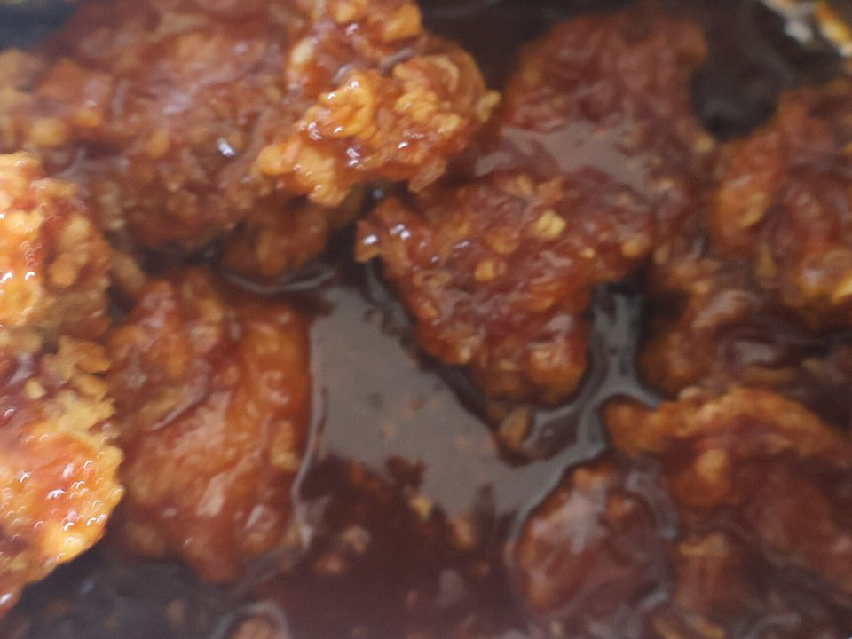

# Sheet-Pan Gochujang Chicken & Broccoli

Photo: Startandstar · CC0 · [source](https://commons.wikimedia.org/wiki/File:Yangnyeom_Chicken_Korean_fried_chicken.jpg)

**Dinner** · Korean · 35 min · serves 4 · skill 1/3

> Sticky, spicy-sweet thighs and charred broccoli off one pan, spooned over jasmine rice with a shower of sesame and scallion.

| Per serving | kcal | Protein | Carbs | Fat | Fiber | Sodium | Cost |
| --- | --- | --- | --- | --- | --- | --- | --- |
| | 635 | 43 g | 79 g | 16 g | 5 g | 1700 mg | $2.80 |

Contains: gluten, sesame, spicy

## Ingredients

- 1½ lb boneless skinless chicken thighs, cut in 2-inch pieces
- 3 tbsp gochujang
- 2 tbsp honey
- 2 tbsp soy sauce
- 4 garlic cloves, grated
- 1 lb broccoli, cut in florets
- 1½ cups jasmine rice
- 4 green onions, sliced
- 1 tbsp sesame seeds

From the pantry: 2 tbsp neutral oil, salt

## Steps

1. Heat the oven to 450°F with a rack in the upper third. Rinse the rice and cook it with 2¼ cups water and a pinch of salt.
2. Whisk the gochujang, honey, soy sauce, garlic and 1 tbsp oil in a big bowl. Add the chicken and toss to coat.
3. Toss the broccoli on a sheet pan with 1 tbsp oil and a pinch of salt and push it to one side. Spread the chicken on the other side in a single layer, scraping in every bit of sauce.
4. Roast 18 to 22 minutes, until the chicken is cooked through and caramelized at the edges and the broccoli tips are charred.
5. Spoon the pan juices back over the chicken. Serve over rice with the green onions and sesame seeds on top.

**Tip:** For extra char, switch to broil for the last 2 minutes and watch it closely. Honey burns fast.

## Storing

Fridge 4 days · freezer up to 3 months. Store chicken and rice in separate containers. Microwave covered, 1½ to 2 minutes, stirring halfway.

## Other ways to make it

- Steak
- Shrimp
- Pork
- Tofu
