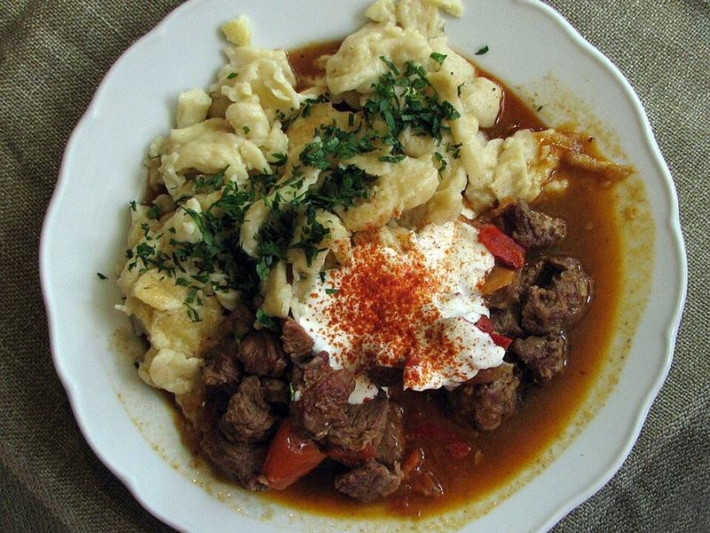

# Hungarian Beef Goulash with Paprika & Potatoes

Photo: Ralf Roletschek · GFDL 1.2 · [source](https://commons.wikimedia.org/wiki/File:2009-09-gulasch-p%C3%B6rk%C3%B6lt-paprikas-2.jpg)

**Dinner** · French & Spanish · 150 min · serves 6 · skill 2/3

> A brick-red, paprika-rich stew of slow-simmered beef, onions, peppers and potatoes, the real Hungarian gulyás, with crusty bread for dunking.

| Per serving | kcal | Protein | Carbs | Fat | Fiber | Sodium | Cost |
| --- | --- | --- | --- | --- | --- | --- | --- |
| | 850 | 49 g | 71 g | 41 g | 8 g | 1360 mg | $4.07 |

Contains: gluten, beef

## Ingredients

- 2½ lb beef chuck, in 1-inch cubes
- 3 onions, diced
- 2 bell peppers, diced
- 4 garlic cloves, minced
- 1 can diced tomatoes
- 4 cups beef broth
- 1½ lb potatoes, in chunks
- 2 carrots, sliced
- ½ cup sour cream, to serve (optional)
- ½ loaf crusty bread

From the pantry: 3 tbsp oil, 3 tbsp sweet paprika, 1 tsp caraway seeds, 1 tsp dried marjoram, 2 bay leaves, 2 tsp salt, ½ tsp black pepper

## Steps

1. Season the beef with 1 tsp salt and the pepper. Brown in batches in the oil in a Dutch oven over medium-high, 4 to 5 minutes per batch. Move to a bowl.
2. Lower the heat to medium, add the onions and cook until soft and golden, 8 to 10 minutes. Add the garlic and caraway for 1 minute.
3. Take the pot off the heat and stir in the paprika (paprika burns easily over direct heat). Return the beef with the tomatoes, broth, marjoram and bay leaves.
4. Bring to a simmer, cover and cook on low for 1½ hours. Add the potatoes, carrots, peppers and remaining salt and simmer until everything is tender, 30 to 40 minutes.
5. Taste for salt and serve in bowls with a spoonful of sour cream and crusty bread.

**Tip:** Use fresh sweet Hungarian paprika if you can get it. A stale jar makes the stew taste flat and dusty.

## Storing

Fridge 4 days · freezer up to 3 months. Reheat on the stove over medium until simmering, or microwave 2 to 3 minutes, stirring once.

