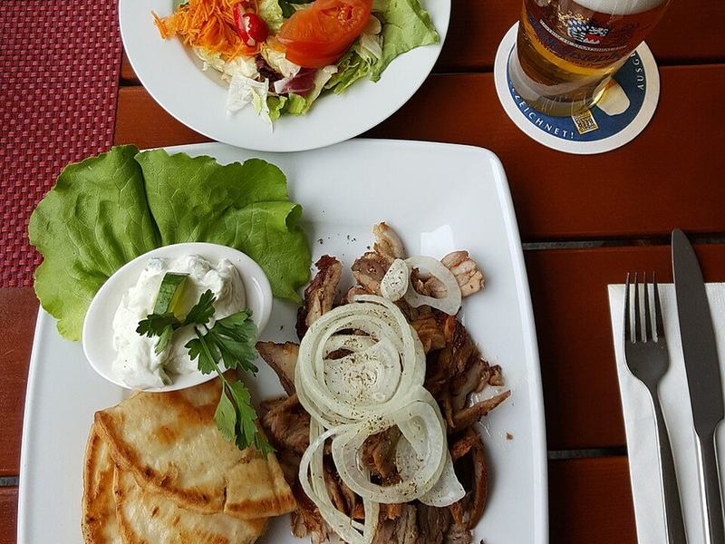

# Greek Chicken Pita Bowls with Tzatziki

Photo: User:Mattes · CC BY 2.0 de · [source](https://commons.wikimedia.org/wiki/File:Pitagyros_mit_Beilagen_und_Bier_(Gastst%C3%A4tte).jpg)

**Dinner** · Greek & Mediterranean · 30 min · serves 4 · skill 2/3

> Lemon-oregano chicken over crisp greens with tomatoes, cucumber, feta, hummus and warm pita for scooping.

| Per serving | kcal | Protein | Carbs | Fat | Fiber | Sodium | Cost |
| --- | --- | --- | --- | --- | --- | --- | --- |
| | 695 | 54 g | 53 g | 30 g | 6 g | 1340 mg | $4.49 |

Contains: dairy, gluten, sesame

## Ingredients

- 1½ lb chicken breasts
- 2 lemons
- 3 garlic cloves, grated
- 12 oz tzatziki
- 1 cup hummus
- 5 oz spring mix
- 1½ cups cherry tomatoes, halved
- 1 cucumber, chopped
- ½ cup feta crumbles
- 4 pita breads

From the pantry: 3 tbsp olive oil, 2 tsp dried oregano, salt, pepper

## Steps

1. Pound the chicken to an even ¾ inch. Toss with the juice of 1 lemon, the garlic, oregano, 2 tbsp oil, 1 tsp salt and pepper. Marinate 10 minutes or up to a day.
2. Cook in a hot grill pan or skillet, 5 to 6 minutes per side, until 165°F inside. Rest 5 minutes and slice.
3. Warm the pitas in the same pan and cut into wedges.
4. Build bowls with greens, tomatoes, cucumber, chicken, a big spoon each of hummus and tzatziki, and feta.
5. Finish with olive oil, a squeeze of the second lemon and more oregano.

**Tip:** Marinate the night before and dinner takes fifteen minutes.

## Storing

Fridge 4 days · freezer up to 3 months. Store chicken, salad and sauces separately. Chicken is great cold or microwaved 1 minute.

## Other ways to make it

- Steak
- Shrimp
- Pork
- Tofu
