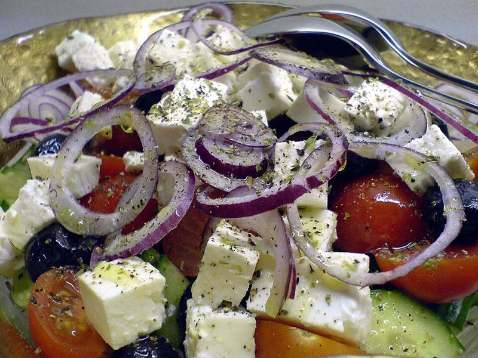

# Greek Salad with Grilled Chicken

Photo: cyclonebill · CC BY-SA 2.0 · [source](https://commons.wikimedia.org/wiki/File:Flickr_-_cyclonebill_-_Gr%C3%A6sk_salat.jpg)

**Lunch** · Greek · 25 min · serves 4 · skill 1/3

> A big, crunchy horiatiki-style salad of tomatoes, cucumber, peppers, olives and feta with lemon-oregano chicken.

| Per serving | kcal | Protein | Carbs | Fat | Fiber | Sodium | Cost |
| --- | --- | --- | --- | --- | --- | --- | --- |
| | 560 | 48 g | 21 g | 33 g | 7 g | 1240 mg | $4.52 |

Contains: dairy

## Ingredients

- 1½ lb chicken breasts
- 2 romaine hearts
- 1 pint tomatoes
- 1 cucumber
- 1 green pepper
- ½ red onion
- kalamata olives
- 6 oz feta
- 2 lemons

From the pantry: ⅓ cup olive oil, 2 tbsp red wine vinegar, 2 tsp oregano, salt, pepper

## Steps

1. Marinate the chicken in 2 tbsp oil, juice of 1 lemon, oregano and salt for 10 minutes.
2. Grill or sear 5 to 6 minutes per side until cooked. Rest and slice.
3. Chop the lettuce, tomatoes, cucumber, pepper and onion.
4. Whisk the remaining oil with the vinegar, lemon juice, oregano, salt and pepper.
5. Toss the salad with dressing and olives, top with feta and chicken.

**Tip:** Pack dressing separately for lunches and the salad stays crunchy for days.

## Storing

Fridge 3 days · freezer not recommended. Keep dressing separate. Chicken is great cold.

## Other ways to make it

- Steak
- Shrimp
- Pork
- Tofu
