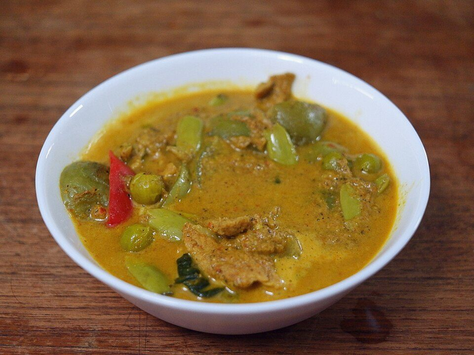

# Thai Green Curry Chicken

Photo: Vee Satayamas from Bangkok, Thailand · CC BY 2.0 · [source](https://commons.wikimedia.org/wiki/File:Green_curry_(42296614864).jpg)

**Dinner** · Thai · 30 min · serves 4 · skill 1/3

> Fragrant green curry with tender chicken, bell peppers and green beans in coconut milk, finished with basil and lime.

| Per serving | kcal | Protein | Carbs | Fat | Fiber | Sodium | Cost |
| --- | --- | --- | --- | --- | --- | --- | --- |
| | 905 | 44 g | 65 g | 54 g | 4 g | 1480 mg | $4.14 |

Contains: spicy, fish

## Ingredients

- 1½ lb boneless thighs, sliced
- 3 tbsp green curry paste
- 2 cans coconut milk
- 1 red bell pepper, sliced
- 8 oz green beans, halved
- 1½ tbsp fish sauce
- a big handful of basil
- 2 limes
- 1½ cups jasmine rice

From the pantry: 1 tbsp oil, 1 tbsp brown sugar

## Steps

1. Start the rice. Fry the curry paste in the oil with a few spoons of the thick coconut cream for 2 minutes, until fragrant.
2. Add the chicken and stir to coat, 2 minutes.
3. Add the rest of the coconut milk, the fish sauce and sugar. Simmer 8 minutes.
4. Add the green beans and peppers and simmer 4 minutes more until crisp-tender.
5. Stir in the basil and lime juice. Taste for salt. Serve over rice.

**Tip:** Start with 2 tbsp paste and add more after tasting. Brands vary wildly in heat.

## Storing

Fridge 4 days · freezer up to 3 months. Store curry and rice separately. Reheat on the stove.

## Other ways to make it

- Steak
- Shrimp
- Pork
- Tofu
