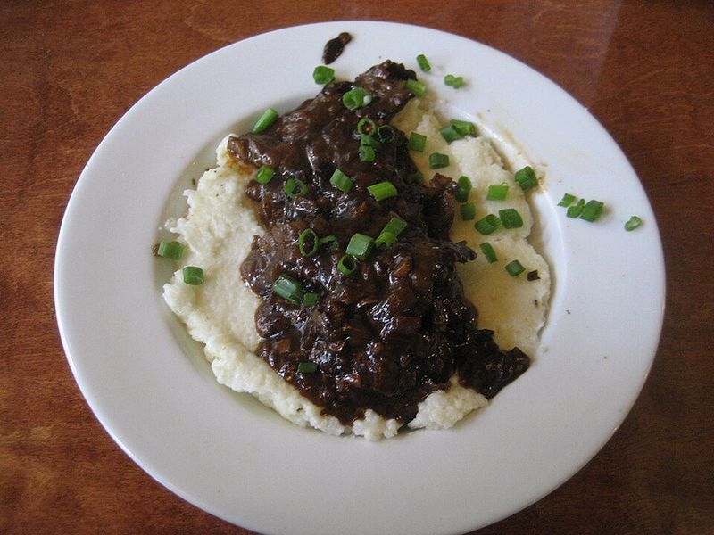

# New Orleans Grillades & Grits

Photo: Infrogmation of New Orleans · CC BY-SA 3.0 · [source](https://commons.wikimedia.org/wiki/File:GreenGoddessGritsGrillades.JPG)

**Breakfast** · Cajun & Creole · 110 min · serves 6 · skill 2/3

> The great New Orleans brunch: thin squares of seared beef braised in a dark-roux gravy with the trinity and tomatoes, ladled over creamy milk-simmered grits.

| Per serving | kcal | Protein | Carbs | Fat | Fiber | Sodium | Cost |
| --- | --- | --- | --- | --- | --- | --- | --- |
| | 595 | 45 g | 51 g | 24 g | 4 g | 960 mg | $2.84 |

Contains: gluten, dairy, beef

## Ingredients

- 2 lb cube steak or thin round steak, cut into 2-inch squares
- 2 onions, diced
- 1 red bell pepper, diced
- 2 celery ribs, diced
- 2 garlic cloves, minced
- 1 can (14.5 oz) diced tomatoes, drained
- 4 tbsp butter
- 3 cups beef broth
- 1½ cups quick grits
- 4 cups milk
- green onions, sliced
- 2 tbsp chopped parsley

From the pantry: ½ cup flour, 2 tbsp oil, 4 tsp Creole or Cajun seasoning, 1 tbsp red wine vinegar, 3 bay leaves, 1 tsp dried thyme, salt, black pepper

## Steps

1. Mix 3 tbsp of the flour with 1 tsp Creole seasoning and ½ tsp salt. Toss the beef squares in it. Brown them in batches in the oil in a large skillet over medium-high, 1 to 2 minutes per side, and set aside.
2. Lower the heat to medium and cook the onions, bell pepper and celery in the same pan until soft, 6 to 8 minutes, scraping up the browned bits. Add the garlic and tomatoes for 3 minutes, then tip the vegetables into a bowl.
3. Melt the butter in the pan, whisk in the remaining flour and stir constantly over medium until the roux is the color of milk chocolate, 5 to 6 minutes. Slowly whisk in the broth and vinegar until smooth and thick.
4. Return the vegetables and beef, add the bay leaves, thyme and remaining Creole seasoning, cover and simmer gently, stirring now and then, until the beef is fork-tender, about 1 hour.
5. About 15 minutes before serving, bring the milk and 2 cups water with 1 tsp salt to a simmer, whisk in the grits and cook, stirring often, until thick and creamy, 6 to 8 minutes.
6. Fish out the bay leaves, taste the gravy for salt and pepper, and spoon the grillades over bowls of grits with green onions and parsley.

**Tip:** Veal round is the old-school choice. Like most braises, grillades are better made a day ahead, which makes them perfect for a relaxed brunch.

Adapted from [The Daring Gourmet](https://www.daringgourmet.com/new-orleans-grillades-and-grits/).

## Storing

Fridge 4 days · freezer up to 3 months. Store grillades and grits separately. Reheat grillades covered over low; whisk grits with a splash of milk until creamy again.

