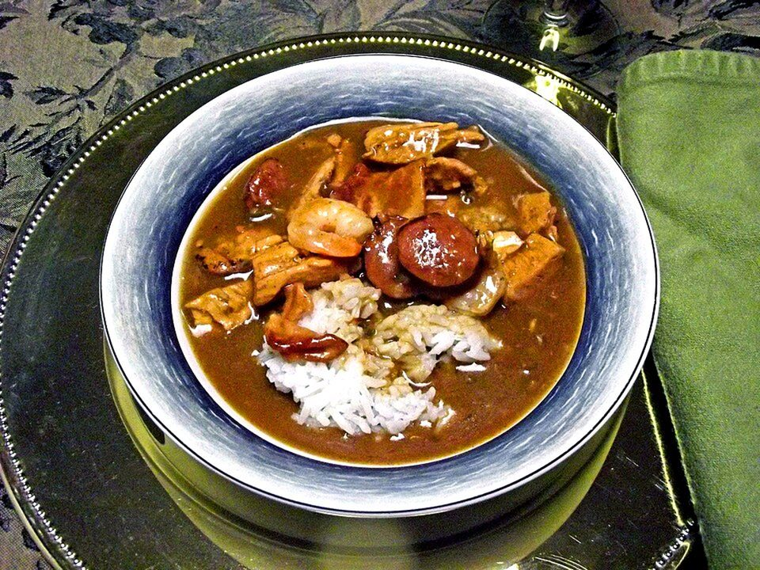

# Chicken & Andouille Gumbo

Photo: Amadscientist · CC BY-SA 3.0 · [source](https://commons.wikimedia.org/wiki/File:Gumbo.JPG)

**Dinner** · Cajun & Creole · 90 min · serves 6 · skill 3/3

> Louisiana in a bowl: a dark chocolate-colored roux, the holy trinity, smoky andouille and tender chicken, ladled over rice.

| Per serving | kcal | Protein | Carbs | Fat | Fiber | Sodium | Cost |
| --- | --- | --- | --- | --- | --- | --- | --- |
| | 685 | 39 g | 60 g | 32 g | 4 g | 2120 mg | $2.85 |

Contains: gluten, pork, spicy

## Ingredients

- 1½ lb boneless thighs
- 12 oz andouille, sliced
- 1 onion, diced
- 1 green pepper
- 2 celery stalks
- 4 garlic cloves
- 6 cups broth
- 12 oz frozen okra
- 2 tbsp Cajun seasoning
- 2 cups rice
- green onions

From the pantry: ½ cup oil, ½ cup flour, 2 bay leaves, hot sauce, filé powder (optional)

## Steps

1. Brown the sausage and chicken in a Dutch oven. Remove.
2. Make the roux: whisk the oil and flour over medium-low, stirring constantly, until the color of milk chocolate, 20 to 30 minutes. Don't walk away. If it burns, start over.
3. Add the onion, pepper and celery and cook 5 minutes, then the garlic and Cajun seasoning.
4. Whisk in the broth slowly, add the bay leaves, chicken, sausage and okra and simmer 45 minutes.
5. Season with hot sauce and serve over rice with green onions.

**Tip:** Have every vegetable chopped before you start the roux. It goes fast at the end.

## Storing

Fridge 4 days · freezer up to 3 months. Reheat on the stove over medium until simmering, or microwave 2 to 3 minutes, stirring once.

## Other ways to make it

- Steak
- Shrimp
- Pork
- Tofu
