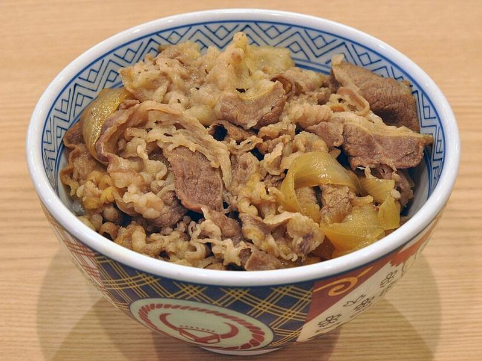

# Gyudon (Japanese Beef & Onion Rice Bowl)

Photo: Ocdp · CC0 · [source](https://commons.wikimedia.org/wiki/File:Gyuu-don_001.jpg)

**Dinner** · Japanese · 20 min · serves 4 · skill 1/3

> Tender shaved beef and sweet onions simmered in a soy-dashi broth, ladled over rice with a soft egg on top.

| Per serving | kcal | Protein | Carbs | Fat | Fiber | Sodium | Cost |
| --- | --- | --- | --- | --- | --- | --- | --- |
| | 595 | 37 g | 66 g | 20 g | 3 g | 1230 mg | $3.12 |

Contains: beef, gluten, egg

## Ingredients

- 1 lb shaved steak
- 2 onions, thinly sliced
- ⅓ cup soy sauce
- 2 tbsp sugar or honey
- 1 cup broth (or dashi)
- 1-inch ginger, julienned
- 4 eggs
- 1½ cups short-grain or jasmine rice
- green onions

From the pantry: 3 tbsp mirin, pickled ginger (optional)

## Steps

1. Start the rice. Simmer the broth, soy, sugar, mirin and ginger in a wide pan.
2. Add the onions and simmer until soft and sweet, 6 minutes.
3. Add the beef, separating the slices, and simmer just until no longer pink, 2 to 3 minutes. Skim any foam.
4. Soft-boil the eggs for 6½ minutes, or crack them into the simmering pan, cover and poach 3 minutes.
5. Spoon the beef, onions and plenty of broth over bowls of rice. Top with the egg and green onions.

**Tip:** Ask the butcher counter for shabu-shabu or Philly cheesesteak beef if you can't find shaved steak.

## Storing

Fridge 3 days · freezer up to 2 months. Store beef in its broth. Reheat on the stove and cook a fresh egg.

## Other ways to make it

- Chicken
- Shrimp
- Pork
- Tofu
