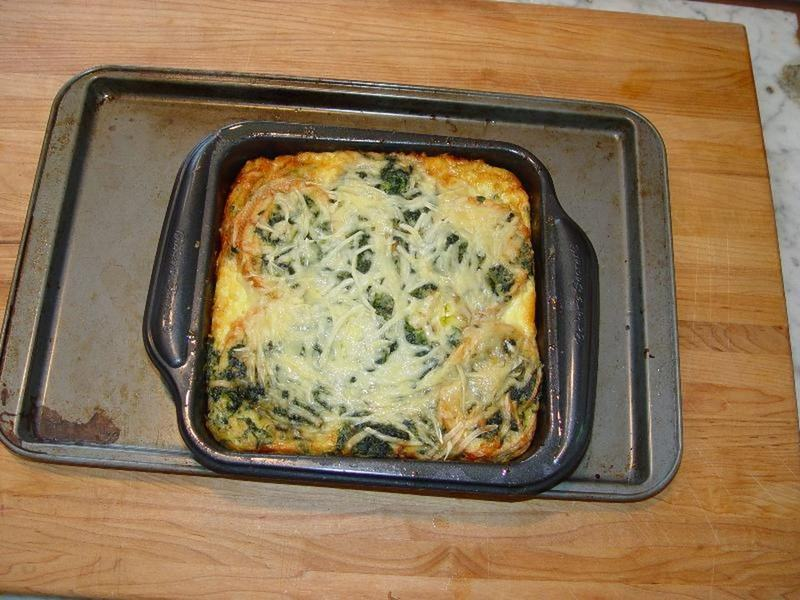

# Make-Ahead Ham & Cheddar Breakfast Strata

Photo: digitalprimate · CC BY 2.0 · [source](https://commons.wikimedia.org/wiki/File:Breakfast_strata.jpg)

**Breakfast** · American comfort · 75 min · serves 6 · skill 1/3

> Cubes of sourdough soaked overnight in a mustardy custard with ham, sharp cheddar and spinach, then baked into a puffed, golden, crisp-topped casserole.

| Per serving | kcal | Protein | Carbs | Fat | Fiber | Sodium | Cost |
| --- | --- | --- | --- | --- | --- | --- | --- |
| | 680 | 42 g | 67 g | 27 g | 3 g | 1770 mg | $2.15 |

Contains: gluten, egg, dairy, pork

## Ingredients

- 1 loaf (16 oz) sourdough, in 1-inch cubes
- 9 oz sliced ham, chopped
- 2 cups shredded sharp cheddar
- 8 eggs
- 2½ cups milk
- 5 oz baby spinach, roughly chopped
- 4 green onions, sliced

From the pantry: 1 tbsp butter, 1 tsp Dijon mustard, ½ tsp salt, pepper

## Steps

1. Butter a 9x13 baking dish. If the bread is fresh, toast the cubes on a sheet pan at 350°F for 10 minutes to dry them out.
2. Layer half the bread in the dish, then half the ham, spinach, green onions and cheese. Repeat with the rest, saving ½ cup cheese for the top.
3. Whisk the eggs, milk, mustard, salt and plenty of pepper. Pour evenly over the bread and press down so every cube gets soaked. Cover and refrigerate at least 4 hours or overnight.
4. Take the dish out 30 minutes before baking and heat the oven to 350°F. Sprinkle the reserved cheese on top.
5. Bake uncovered 45 to 55 minutes, until puffed, golden and a knife in the center comes out without wet egg (160°F inside). Rest 10 minutes before cutting.

**Tip:** Dry, day-old bread is the key. It drinks up the custard without going soggy, so the strata is tender inside with a crisp top.

## Storing

Fridge 4 days · freezer up to 2 months. Cover and chill. Reheat squares in a 350°F oven for 12 to 15 minutes, or microwave 1 to 2 minutes.

