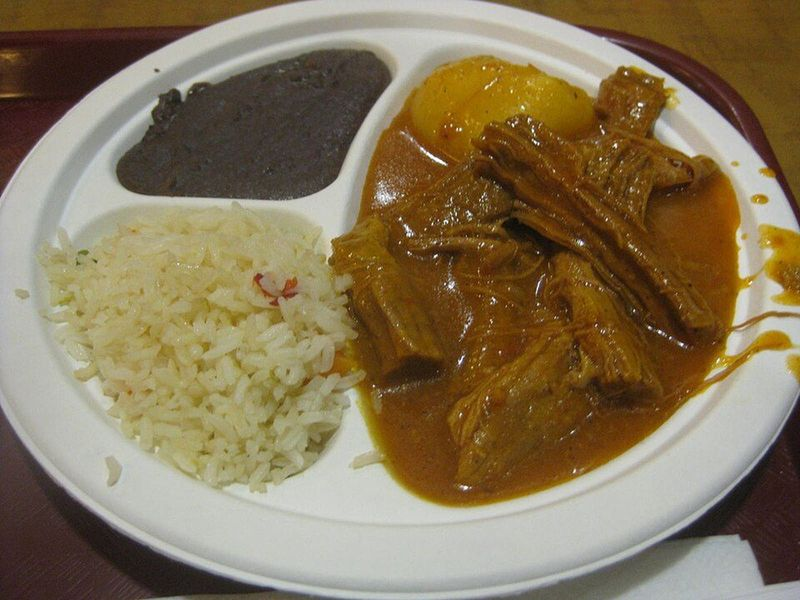

# Hilachas (Guatemalan Shredded Beef in Tomato-Tomatillo Sauce)

Photo: Joshua Heller · CC BY 2.0 · [source](https://commons.wikimedia.org/wiki/File:Hilacha.jpg)

**Dinner** · Salvadoran & Central American · 150 min · serves 6 · skill 2/3

> Flank steak simmered until it falls into 'threads', then stewed with potatoes and carrots in a brick-red sauce of tomatoes, tomatillos, guajillo and ancho chiles thickened with toasted seeds.

| Per serving | kcal | Protein | Carbs | Fat | Fiber | Sodium | Cost |
| --- | --- | --- | --- | --- | --- | --- | --- |
| | 615 | 41 g | 75 g | 17 g | 7 g | 330 mg | $3.74 |

Contains: beef, sesame

## Ingredients

- 2 lb flank steak, in 3 or 4 pieces
- 4 Roma tomatoes
- 2 tomatillos, husked
- ½ onion
- 4 garlic cloves
- 1 tbsp sesame seeds, toasted
- 1 tbsp pepitas, toasted
- 2 dried guajillo chiles, stemmed and seeded
- 1 dried ancho chile, stemmed and seeded
- 2 russet potatoes, peeled and diced
- 3 carrots, sliced
- 1¾ cups rice
- 12 corn tortillas

From the pantry: 3 bay leaves, ¼ tsp ground cumin, 2 tsp salt, ¼ tsp black pepper, 1 tbsp oil

## Steps

1. Put the beef in a large pot with 12 cups water, 1 tsp salt and 2 bay leaves. Bring to a boil, skim, then simmer gently until very tender, about 2 hours, topping up with water so it stays covered. Lift out the beef and save the broth.
2. While the beef cooks, soak the chiles in hot water for 15 minutes. Blend them with the tomatoes, tomatillos, onion, garlic, sesame seeds, pepitas and 1 cup of the broth until completely smooth.
3. Shred the beef by hand into medium threads; too fine and they tangle in the stew. Start the rice.
4. Heat the oil in the pot over medium, add the sauce and fry, stirring, for 3 minutes. Add 2½ cups broth, the beef, cumin, the remaining bay leaf, 1 tsp salt and the pepper and simmer 10 minutes.
5. Add the potatoes and carrots and simmer until fork-tender and the sauce has thickened, 15 to 18 minutes. Serve with rice and warm tortillas.

**Tip:** Hilachas means 'threads'. Many Guatemalan cooks add a handful of toasted breadcrumbs or a soaked tortilla to the blender for a thicker sauce. Save the extra broth for soup.

Adapted from [Latina (Stephanie Alvarado)](https://latina.com/hilachas-a-guatemalan-shredded-beef-stew/).

## Storing

Fridge 4 days · freezer up to 3 months. Reheat covered over medium-low with a splash of the saved broth, about 10 minutes.

