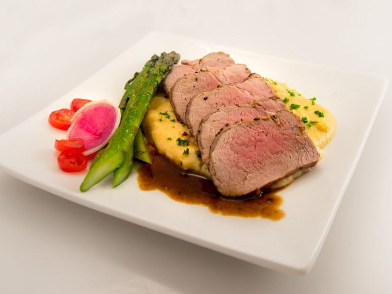

# Honey-Garlic Pork Tenderloin with Green Beans

Photo: User:Ɱ · CC BY-SA 4.0 · [source](https://commons.wikimedia.org/wiki/File:Pork_tenderloin_dish.png)

**Dinner** · American comfort · 35 min · serves 4 · skill 2/3

> Seared-then-roasted pork tenderloin lacquered in honey-garlic glaze, sliced over roasted potatoes and blistered green beans.

| Per serving | kcal | Protein | Carbs | Fat | Fiber | Sodium | Cost |
| --- | --- | --- | --- | --- | --- | --- | --- |
| | 515 | 36 g | 49 g | 20 g | 6 g | 870 mg | $2.76 |

Contains: pork, dairy, gluten

## Ingredients

- 1¼ lb pork tenderloin, silver skin trimmed
- 3 tbsp honey
- 2 tbsp soy sauce
- 5 garlic cloves, minced
- 1 tbsp butter
- 1½ lb baby potatoes, halved
- 12 oz green beans, trimmed

From the pantry: 3 tbsp olive oil, 1 tsp Dijon mustard, salt, pepper

## Steps

1. Heat the oven to 425°F. Toss the potatoes with 1 tbsp oil and salt on a sheet pan and roast 15 minutes.
2. Season the pork generously. Sear in an oven-safe skillet with 1 tbsp oil until browned all over, 6 minutes.
3. Whisk the honey, soy sauce, garlic and Dijon. Pour over the pork. Toss the green beans with the rest of the oil and add them to the potato pan.
4. Roast the pork and the vegetables together for 12 to 15 minutes, until the pork reaches 140°F. Rest the pork 5 minutes.
5. Stir the butter into the skillet juices. Slice the pork and spoon the glaze over it and the vegetables.

**Tip:** Pull the pork at 140°F. Carryover heat takes it to a juicy 145°F while it rests.

## Storing

Fridge 4 days · freezer up to 3 months. Slice only what you'll eat. Microwave covered, 1½ to 2 minutes, stirring halfway.

## Other ways to make it

- Chicken
- Steak
- Shrimp
- Tofu
