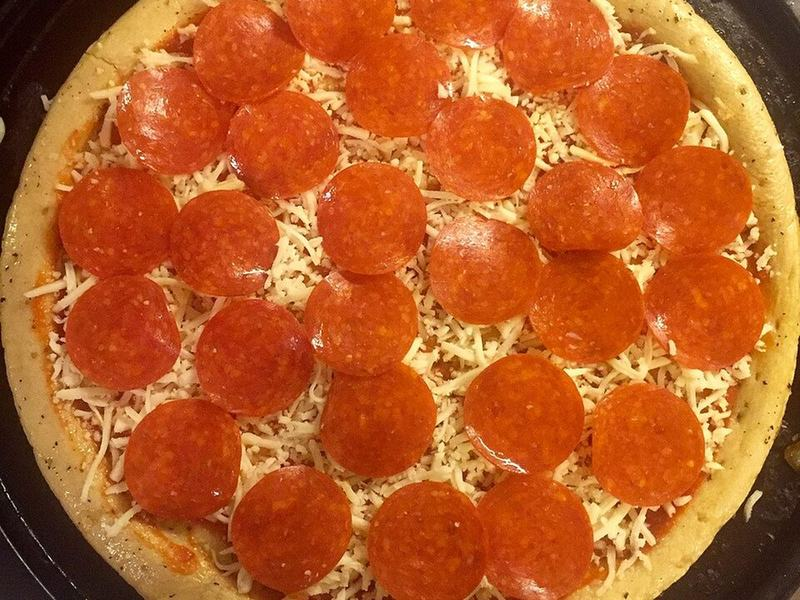

# Hot Honey Pepperoni Flatbread Pizza

Photo: Jonathan Cutrer from San Angelo, United States · CC BY 2.0 · [source](https://commons.wikimedia.org/wiki/File:Pepperoni_Pizza_(29204589095).jpg)

**Dinner** · Italian · 15 min · serves 2 · skill 1/3

> Friday night in fifteen minutes: naan crisped in a hot oven with marinara, melty mozzarella, cupped pepperoni and a chili-honey drizzle.

| Per serving | kcal | Protein | Carbs | Fat | Fiber | Sodium | Cost |
| --- | --- | --- | --- | --- | --- | --- | --- |
| | 955 | 48 g | 71 g | 52 g | 4 g | 2420 mg | $3.09 |

Contains: pork, dairy, gluten, spicy

## Ingredients

- 2 naan flatbreads
- ½ cup marinara
- 1½ cups shredded mozzarella
- 3 oz pepperoni
- 2 tbsp honey
- a handful of spring mix or basil

From the pantry: 1 tsp red pepper flakes, olive oil, dried oregano

## Steps

1. Heat the oven to 475°F. Put the naan straight on the rack for 2 minutes to crisp the bottoms.
2. Spread the marinara on the naan, then the mozzarella, then the pepperoni.
3. Bake on a sheet pan until the cheese is bubbling and the pepperoni cups and crisps, 7 to 8 minutes.
4. Warm the honey with the pepper flakes for 20 seconds in the microwave.
5. Drizzle the hot honey over the pizzas, add the greens and a pinch of oregano, and slice.

**Tip:** Thicker pepperoni cups better. Look for the slices sold in a stick or a deli tray.

## Storing

Fridge 3 days · freezer up to 2 months. Reheat in a 400°F oven or air fryer for 4 to 5 minutes to re-crisp.

