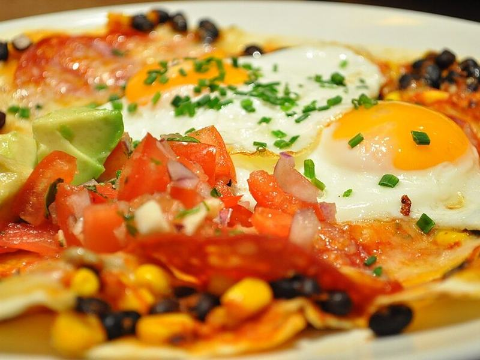

# Huevos Rancheros

Photo: London Chow · CC BY 2.0 · [source](https://commons.wikimedia.org/wiki/File:Giraffe_review_Islington_Essex_Road_huevos_rancheros.jpg)

**Breakfast** · Mexican · 20 min · serves 4 · skill 1/3

> Crisp corn tortillas topped with warm refried beans, crispy fried eggs, ranchero salsa, avocado and crumbled cheese.

| Per serving | kcal | Protein | Carbs | Fat | Fiber | Sodium | Cost |
| --- | --- | --- | --- | --- | --- | --- | --- |
| | 620 | 27 g | 48 g | 38 g | 15 g | 1950 mg | $2.07 |

Contains: egg, dairy

## Ingredients

- 8 corn tortillas
- 1 can refried beans
- 8 eggs
- 16 oz salsa
- 2 avocados
- cotija or feta
- cilantro
- 1 lime

From the pantry: 3 tbsp oil, salt, hot sauce

## Steps

1. Fry the tortillas in 2 tbsp oil until crisp at the edges. Drain.
2. Warm the beans with a splash of water. Warm the salsa in a small pan.
3. Fry the eggs in the remaining oil until the edges are crispy and the yolks runny.
4. Top 2 tortillas per plate with beans, 2 eggs and warm salsa.
5. Finish with avocado, cheese, cilantro and lime.

**Tip:** Spoon hot oil over the egg whites as they fry to set them without flipping.

## Storing

Fridge 0 days · freezer not recommended. Best made fresh. Leftover beans and salsa keep 4 days.

