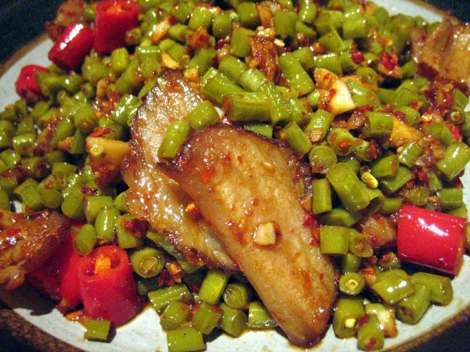

# Hunan Farmhouse Pork with Blistered Peppers

Photo: Prince Roy · CC BY-SA 2.0 · [source](https://commons.wikimedia.org/wiki/File:Hunan_Cured_Ham.jpg)

**Dinner** · Sichuan & Hunan · 30 min · serves 4 · skill 2/3

> Nong jia xiao chao rou, the dish every Hunan home cook makes: thin slices of pork belly and lean pork seared hard with charred green peppers, garlic and chili. It's smoky, salty, and gone in minutes with plenty of rice.

| Per serving | kcal | Protein | Carbs | Fat | Fiber | Sodium | Cost |
| --- | --- | --- | --- | --- | --- | --- | --- |
| | 825 | 28 g | 71 g | 46 g | 3 g | 890 mg | $2.50 |

Contains: gluten, pork, spicy

## Ingredients

- 10 oz skinless pork belly, very thinly sliced
- 10 oz pork tenderloin, thinly sliced
- 2 green bell peppers, in thin strips
- 3 jalapeños, sliced on the diagonal
- 5 garlic cloves, sliced
- 3 thin slices ginger, slivered
- 4 dried red chilies, snipped
- 2 tbsp soy sauce, divided
- 1 tsp dark soy sauce
- 2 tbsp Shaoxing wine
- 1½ cups jasmine rice

From the pantry: 1 tsp cornstarch, ½ tsp sugar, ¼ tsp white pepper, 2 tbsp oil, salt

## Steps

1. Start the rice. Toss the lean pork with 1 tsp soy, the dark soy, 1 tbsp Shaoxing wine, cornstarch and white pepper and let it sit 10 minutes.
2. Heat a wok or large cast-iron skillet over high with no oil. Add the peppers and jalapeños with a pinch of salt and press them against the pan until blistered and softened in spots, 3 to 4 minutes. Move to a plate.
3. Add the pork belly to the empty pan and stir-fry over medium-high until the fat renders and the edges curl and brown, 4 to 5 minutes. Pour off all but about 2 tbsp fat.
4. Add the oil and the marinated pork and stir-fry until it just loses its pink, about 2 minutes. Add the garlic, ginger and dried chilies and toss for 30 seconds.
5. Return the peppers, add the remaining soy, wine and the sugar, and toss over high heat until everything is glossy and lightly charred, about 1 minute. Serve with rice.

**Tip:** In Hunan this is made with thin, hot green chilies and a spoonful of fermented black beans. If you can find Anaheim or Hatch peppers and a jar of black beans, use them instead of the bell peppers.

Adapted from [SBS Food (Adam Liaw)](https://www.sbs.com.au/food/the-cook-up-with-adam-liaw/recipe/hunan-style-fried-pork-peppers/uag1jyopw).

## Storing

Fridge 3 days · freezer up to 2 months. Reheat in a very hot skillet for 2 minutes.

