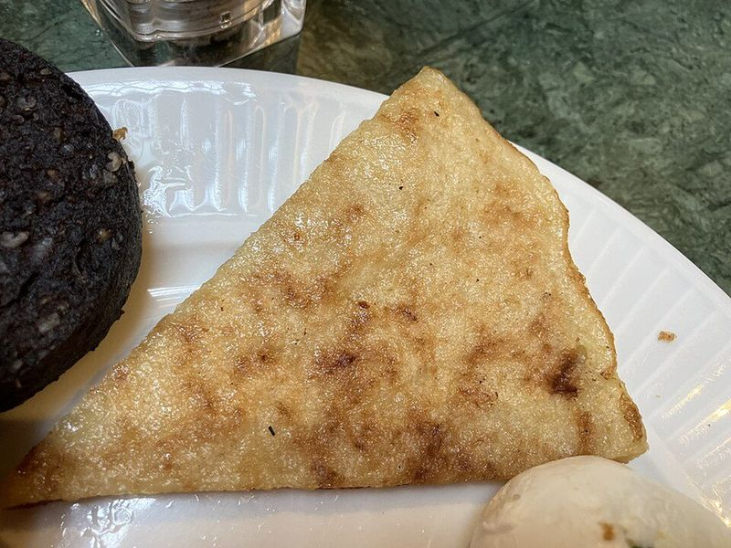

# Irish Boxty Potato Pancakes with Bacon & Fried Eggs

Photo: さえぼー · CC0 · [source](https://commons.wikimedia.org/wiki/File:Boxty_triangle.jpg)

**Breakfast** · British & Irish · 60 min · serves 4 · skill 2/3

> Crisp-edged Irish potato pancakes made with both grated raw and mashed potato for a fluffy middle, fried in butter and served the Irish way with bacon and runny eggs.

| Per serving | kcal | Protein | Carbs | Fat | Fiber | Sodium | Cost |
| --- | --- | --- | --- | --- | --- | --- | --- |
| | 470 | 21 g | 47 g | 22 g | 5 g | 890 mg | $1.61 |

Contains: gluten, dairy, egg, pork

## Ingredients

- 1½ lb russet potatoes (2 large), peeled
- 1 cup buttermilk, plus more if needed
- 4 green onions, sliced
- 3 tbsp butter, for frying
- 8 oz thick-cut bacon
- 4 eggs

From the pantry: 1 cup flour, ½ tsp baking soda, 1 tsp salt, pepper

## Steps

1. Cut half the potatoes into chunks and boil until very tender, 12 to 15 minutes. Drain and mash until smooth; spread out to cool for 10 minutes.
2. Grate the rest of the potatoes on the large holes of a box grater, then wring out as much liquid as you can in a clean towel.
3. Mix the flour, baking soda and salt in a bowl. Add the mash, grated potato and green onions, then stir in enough buttermilk to make a thick, scoopable batter.
4. Cook the bacon in a large skillet over medium until crisp; keep warm in a 200°F oven. Pour off most of the fat and add 1 tbsp butter.
5. Drop ⅓-cup scoops of batter into the pan, flatten to ½ inch and fry over medium until deep golden and cooked through, 4 to 5 minutes per side, adding butter as needed. Keep warm.
6. Fry the eggs in the last of the butter and serve on top of the boxty with the bacon.

**Tip:** Leftover mashed potatoes make this much quicker. Squeezing the grated potato really dry is what keeps boxty crisp instead of gummy.

Adapted from [The Daring Gourmet](https://www.daringgourmet.com/boxty-irish-potato-pancakes/).

## Storing

Fridge 3 days · freezer up to 2 months. Freeze cooled boxty between parchment. Re-crisp in a skillet or a 400°F oven for 8 to 10 minutes.

