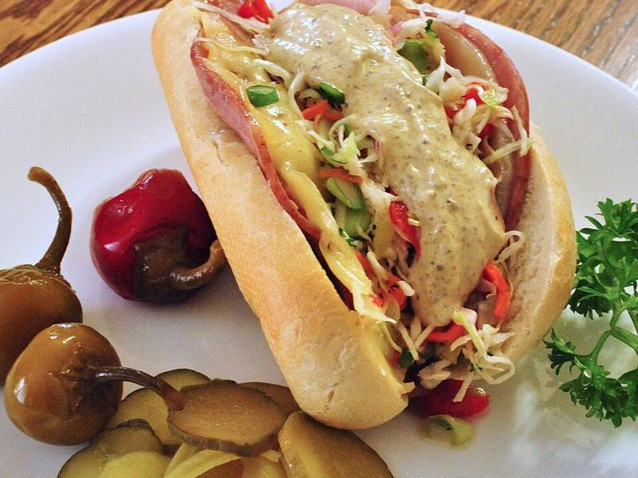

# Italian Grinder Sandwiches

Photo: jeffreyw · CC BY 2.0 · [source](https://commons.wikimedia.org/wiki/File:Mmm..._salami,_ham,_and_cheeses_on_a_hoagie_roll_(6879014927).jpg)

**Lunch** · Italian · 15 min · serves 4 · skill 1/3

> Toasted hoagie rolls stacked with salami, turkey and melted provolone, piled high with the viral tangy, creamy shredded-lettuce grinder salad.

| Per serving | kcal | Protein | Carbs | Fat | Fiber | Sodium | Cost |
| --- | --- | --- | --- | --- | --- | --- | --- |
| | 835 | 44 g | 52 g | 49 g | 4 g | 2770 mg | $3.05 |

Contains: pork, dairy, gluten, egg

## Ingredients

- 4 hoagie rolls
- 7 oz sliced Genoa salami
- 6 oz sliced turkey
- 8 slices provolone
- 2 romaine hearts, finely shredded
- ¼ onion, thinly sliced
- pepperoncini or jalapeño
- ¼ cup grated Parmesan

From the pantry: Grinder dressing: ⅓ cup mayo, 2 tbsp red wine vinegar, 1 tsp oregano, 1 garlic clove, chili flakes, salt, pepper

## Steps

1. Stir together the mayo, vinegar, oregano, grated garlic, chili flakes and Parmesan.
2. Toss the lettuce, onion and sliced peppers with the dressing.
3. Split the rolls and layer salami, turkey and provolone on both halves.
4. Toast open-faced under the broiler until the cheese melts and the bread crisps, 2 to 3 minutes.
5. Pile on the grinder salad, close and slice in half.

**Tip:** Slice the lettuce as thin as you can. It should be almost like slaw.

## Storing

Fridge 1 days · freezer not recommended. Store the grinder salad separately and assemble fresh.

