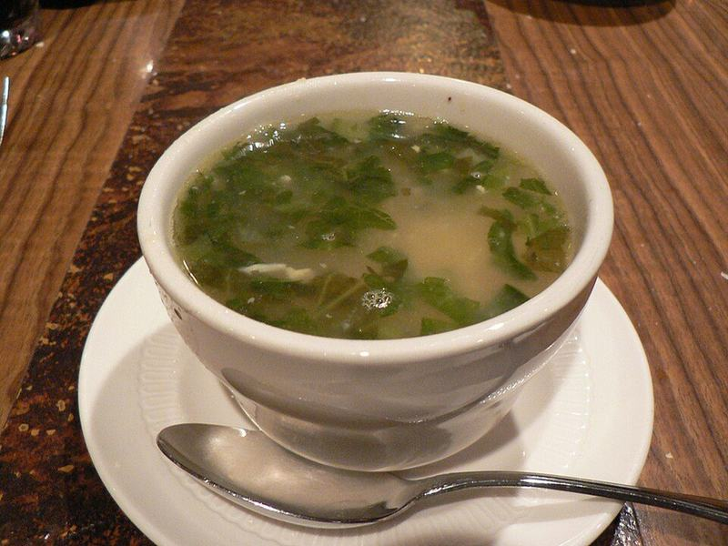

# Italian Wedding Soup with Mini Turkey Meatballs

Photo: Unknown · CC BY-SA 2.0 · [source](https://commons.wikimedia.org/wiki/File:Wedding_soup.jpg)

**Lunch** · Italian · 50 min · serves 6 · skill 2/3

> Dozens of tiny, tender Parmesan turkey meatballs simmered in a light, lemony broth with orzo, carrots and silky spinach.

| Per serving | kcal | Protein | Carbs | Fat | Fiber | Sodium | Cost |
| --- | --- | --- | --- | --- | --- | --- | --- |
| | 430 | 29 g | 42 g | 17 g | 4 g | 2010 mg | $2.34 |

Contains: gluten, dairy, egg

## Ingredients

- 1 lb ground turkey
- 1 egg
- ½ cup panko
- ¾ cup grated Parmesan, divided
- 12 cups (3 cartons) chicken broth
- 1⅓ cups orzo
- 5 oz baby spinach
- 2 carrots, diced
- 2 celery stalks, diced
- 1 onion, diced
- 4 garlic cloves, minced
- ¼ cup chopped parsley
- 1 lemon

From the pantry: 2 tbsp olive oil, 1 tsp dried oregano, ½ tsp garlic powder, salt, pepper

## Steps

1. Mix the turkey, egg, panko, ½ cup of the Parmesan, half the parsley, the garlic powder, ½ tsp salt and pepper with your hands until just combined. Roll into 1-inch balls; you should get about 40.
2. Warm the oil in a large pot over medium heat. Add the onion, carrots and celery and cook until soft, 7 to 8 minutes, then stir in the garlic and oregano for 30 seconds.
3. Add the broth and bring to a boil. Lower to a steady simmer and drop in the meatballs one at a time. Simmer until they float and are cooked through, about 10 minutes.
4. Stir in the orzo and simmer, stirring occasionally so it doesn't stick, until tender, 8 to 10 minutes.
5. Stir in the spinach and the rest of the parsley until wilted. Add a squeeze of lemon, season with salt and pepper, and serve with the remaining Parmesan.

**Tip:** Wet your hands with cold water while rolling the meatballs so the mixture doesn't stick and they stay round.

## Storing

Fridge 4 days · freezer up to 3 months. The orzo drinks up broth, so add water or broth when reheating on the stove.

## Other ways to make it

- Ground beef
- Ground pork
- Italian sausage
- Lentils (veg)
