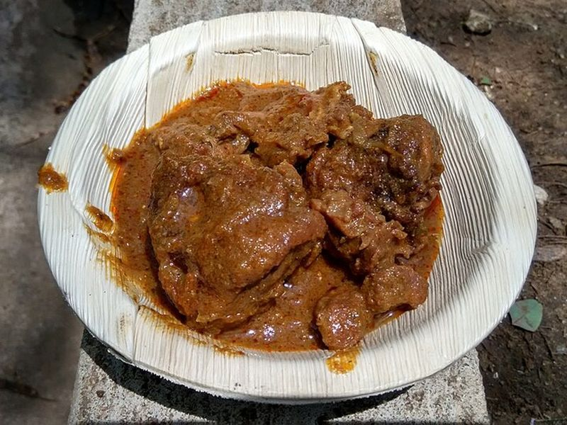

# Jamaican Curry Chicken with Potatoes & Carrots

Photo: Thamizhpparithi Maari · CC BY-SA 4.0 · [source](https://commons.wikimedia.org/wiki/File:Aesthetic_Chicken_Curry.jpg)

**Dinner** · Jamaican · 75 min · serves 5 · skill 2/3

> Chicken marinated in curry powder, scallion, garlic and ginger, then simmered with thyme, allspice and a whole scotch bonnet until the potatoes melt into a rich golden gravy.

| Per serving | kcal | Protein | Carbs | Fat | Fiber | Sodium | Cost |
| --- | --- | --- | --- | --- | --- | --- | --- |
| | 755 | 55 g | 90 g | 19 g | 8 g | 800 mg | $2.96 |

Contains: spicy

## Ingredients

- 2½ lb boneless chicken thighs, in 2-inch chunks
- 3 tbsp Jamaican curry powder, divided
- 4 scallions, chopped
- ½ onion, chopped
- 4 garlic cloves, minced
- 1 tbsp minced fresh ginger
- 1 whole scotch bonnet pepper
- 1 large russet potato, in 1-inch cubes
- 3 carrots, in chunks
- 2 cups chicken broth
- 2 cups long-grain white rice

From the pantry: 3 tbsp oil, 1 tbsp tomato paste, 1 tsp whole allspice berries, 1 tsp dried thyme, salt, pepper

## Steps

1. Toss the chicken with 2 tbsp curry powder, half the scallions, the onion, garlic, ginger and 1½ tsp salt. Marinate at least 30 minutes, or overnight in the fridge.
2. Heat the oil in a Dutch oven over medium heat. Add the last tablespoon of curry powder and stir until it darkens a shade and smells toasty, about 1 minute. This is 'burning' the curry.
3. Raise the heat to medium-high, add the chicken with all its marinade and stir until well coated and lightly browned, 5 to 6 minutes.
4. Stir in the tomato paste, thyme, allspice and rest of the scallions, then add the broth, potatoes and carrots. Lay the scotch bonnet on top whole.
5. Cover and simmer on medium-low for 35 to 40 minutes, stirring now and then, until the potatoes are soft and starting to thicken the gravy. Cook the rice meanwhile.
6. Remove the scotch bonnet (unless you want serious heat), season with salt and pepper, and serve over rice.

**Tip:** Jamaican curry powder (Betapac, Blue Mountain or Grace) is heavier on allspice and lighter on turmeric than Indian blends. Leave the scotch bonnet whole for flavor without too much fire.

Adapted from [The Stush Kitchen](https://thestushkitchen.com/authentic-jamaican-curry-chicken-recipe/).

## Storing

Fridge 4 days · freezer up to 3 months. Refrigerate in glass (curry stains). Reheat on the stove with a splash of water until bubbling.

