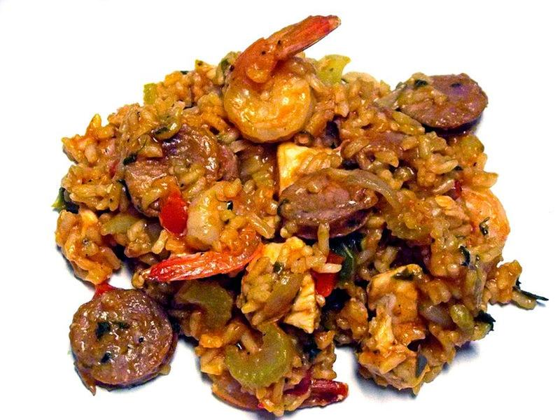

# Cajun Shrimp & Andouille Jambalaya

Photo: Amadscientist · CC BY-SA 3.0 · [source](https://commons.wikimedia.org/wiki/File:Homemade_Jambalaya.JPG)

**Dinner** · Cajun & Creole · 50 min · serves 6 · skill 2/3

> New Orleans in one pot: smoky andouille, the Cajun trinity, tomatoes and rice simmered in spiced broth with shrimp folded in at the end.

| Per serving | kcal | Protein | Carbs | Fat | Fiber | Sodium | Cost |
| --- | --- | --- | --- | --- | --- | --- | --- |
| | 455 | 29 g | 44 g | 18 g | 3 g | 1930 mg | $2.86 |

Contains: shellfish, pork, spicy

## Ingredients

- 12 oz andouille sausage, sliced
- 1 lb shrimp, peeled
- 1 onion, diced
- 1 green bell pepper, diced
- 2 celery stalks, diced
- 4 garlic cloves
- 1 can diced tomatoes
- 1½ cups long-grain rice
- 3 cups chicken broth
- 1½ tbsp Cajun seasoning
- green onions

From the pantry: 1 tbsp oil, 2 bay leaves, hot sauce

## Steps

1. Brown the sausage in the oil in a Dutch oven, 5 minutes. Add the onion, pepper and celery and cook until soft, 6 minutes.
2. Add the garlic, Cajun seasoning and rice and stir 1 minute.
3. Add the tomatoes, broth and bay leaves. Bring to a boil, cover and simmer on low 20 minutes without lifting the lid.
4. Toss the shrimp with a pinch of Cajun seasoning, scatter over the rice, cover and cook 5 to 7 minutes until pink.
5. Fluff gently and serve with green onions and hot sauce.

**Tip:** Keep the lid on while the rice simmers. Lifting it lets out the steam the rice needs.

## Storing

Fridge 3 days · freezer not recommended. Shrimp toughens when frozen. Microwave covered, 1½ to 2 minutes, stirring halfway.

## Other ways to make it

- Chicken
- Steak
- Pork
- Tofu
