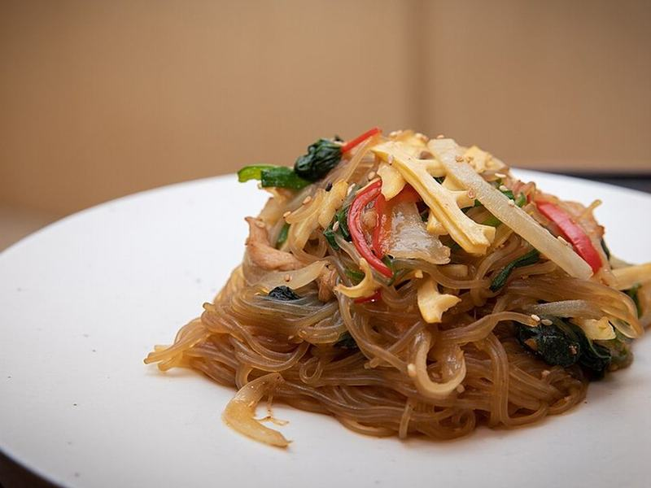

# Japchae (Korean Glass Noodles)

Photo: korea.net · CC BY-SA 2.0 · [source](https://commons.wikimedia.org/wiki/File:Polish_Korean_Cuisine_and_Culture_Exchanges_Gradmother%E2%80%99s_Recipes_05.jpg)

**Dinner** · Korean · 35 min · serves 4 · skill 2/3

> Chewy sweet-potato glass noodles stir-fried with beef, spinach, carrots, peppers and onions in a sweet sesame-soy sauce.

| Per serving | kcal | Protein | Carbs | Fat | Fiber | Sodium | Cost |
| --- | --- | --- | --- | --- | --- | --- | --- |
| | 545 | 16 g | 72 g | 23 g | 5 g | 1000 mg | $2.81 |

Contains: beef, gluten, sesame

## Ingredients

- 8 oz sweet potato glass noodles
- 8 oz shaved steak
- 5 oz spinach
- 1 carrot, in matchsticks
- 1 bell pepper, sliced
- 1 onion, sliced
- ⅓ cup soy sauce
- 2 tbsp sugar or honey
- 4 garlic cloves
- sesame seeds

From the pantry: 3 tbsp sesame oil, 1 tbsp oil

## Steps

1. Boil the noodles 6 minutes, drain, rinse and snip into shorter lengths. Toss with 1 tbsp sesame oil.
2. Whisk the soy, sugar, garlic and 1 tbsp sesame oil. Marinate the beef in 2 tbsp of it.
3. Stir-fry the vegetables one at a time in a little oil, lightly salting each, and set aside. Wilt the spinach last.
4. Stir-fry the beef until browned, 2 minutes.
5. Toss everything with the noodles and remaining sauce over low heat until glossy. Finish with sesame oil and seeds.

**Tip:** Japchae is great at room temperature, so it's perfect for lunches.

## Storing

Fridge 4 days · freezer not recommended. Microwave 1 to 2 minutes or eat at room temperature.

## Other ways to make it

- Chicken
- Shrimp
- Pork
- Tofu
