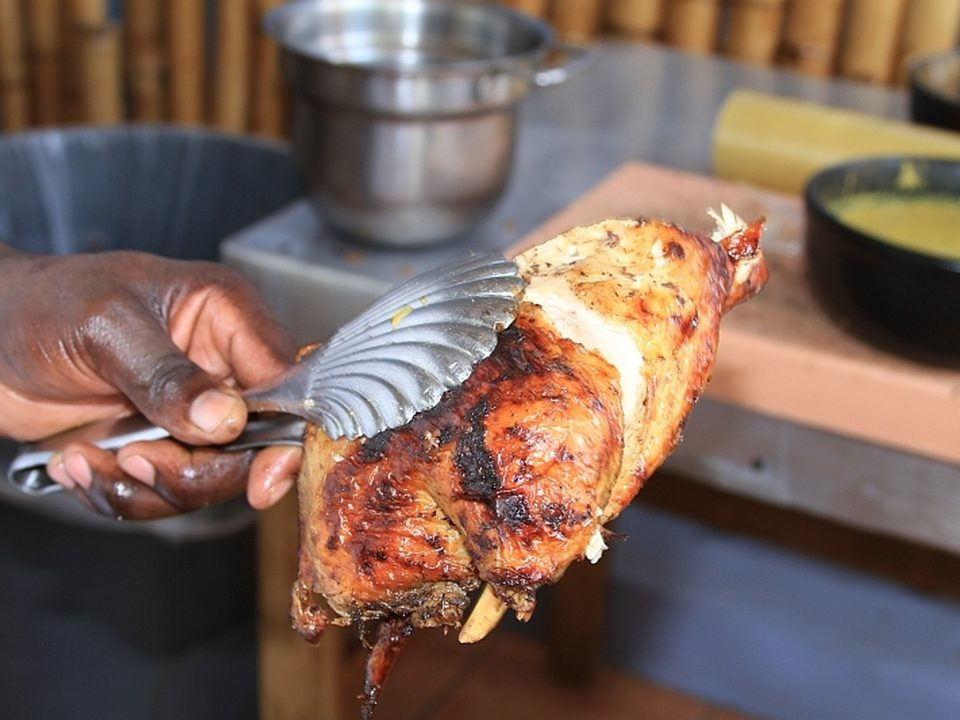

# Jerk Chicken with Rice & Peas

Photo: OUTography.com from Gilbert, AZ, USA · CC BY 2.0 · [source](https://commons.wikimedia.org/wiki/File:BBQJerk_Chicken.jpg)

**Dinner** · Jamaican · 55 min · serves 4 · skill 2/3

> Smoky, fiery jerk-marinated chicken charred until sticky, with coconut rice and beans and sweet fried plantains.

| Per serving | kcal | Protein | Carbs | Fat | Fiber | Sodium | Cost |
| --- | --- | --- | --- | --- | --- | --- | --- |
| | 1025 | 59 g | 108 g | 42 g | 10 g | 2250 mg | $3.79 |

Contains: spicy

## Ingredients

- 2 lb chicken thighs
- 2 tbsp jerk seasoning
- 2 limes
- 1 bunch green onions
- 4 garlic cloves
- 1 scotch bonnet or jalapeño
- 1½ cups long-grain rice
- 1 can kidney beans
- 1 can coconut milk
- 2 ripe plantains

From the pantry: 2 tbsp soy sauce, 2 tbsp brown sugar, 1 tsp allspice, 1 tsp thyme, 3 tbsp oil, salt

## Steps

1. Blend the jerk seasoning, lime juice, half the green onions, garlic, chili, soy, sugar, allspice, thyme and 1 tbsp oil. Rub over the chicken and marinate at least 1 hour or overnight.
2. Roast at 425°F for 30 minutes, then broil 3 to 5 minutes until charred.
3. For rice and peas: simmer the coconut milk, beans with their liquid, rice, thyme, remaining green onions, 1 tsp salt and 1 cup water. Cover and cook on low 20 minutes.
4. Slice the plantains on a diagonal and fry in 2 tbsp oil until caramelized, 2 to 3 minutes per side.
5. Serve the chicken with rice and peas, plantains and lime wedges.

**Tip:** Use very ripe, nearly black plantains. They're the sweetest.

## Storing

Fridge 4 days · freezer up to 3 months. Reheat chicken at 375°F for 15 minutes. Microwave rice with a splash of water.

## Other ways to make it

- Steak
- Shrimp
- Pork
- Tofu
