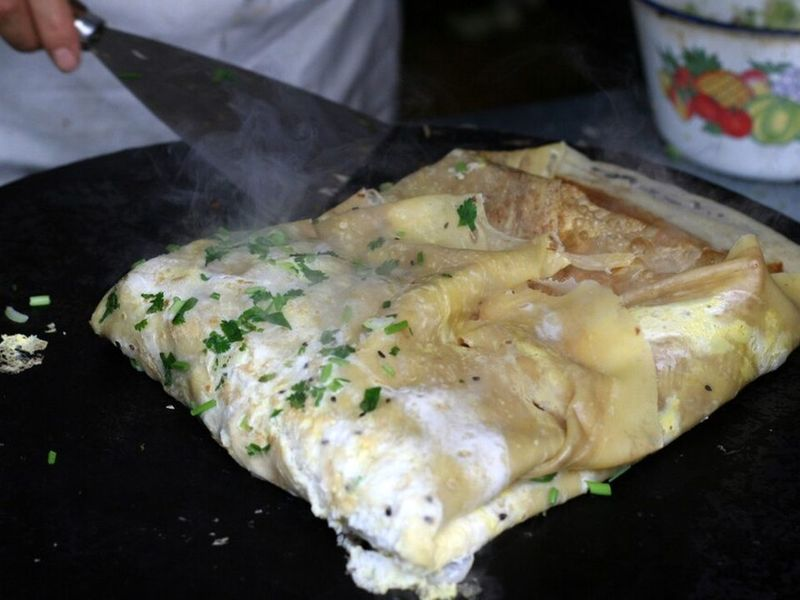

# Jianbing (Chinese Egg Crepes with Crispy Wonton Crackers)

Photo: Ernie from beijing, china · CC BY 2.0 · [source](https://commons.wikimedia.org/wiki/File:Jianbing_1.jpg)

**Breakfast** · Chinese & Cantonese · 35 min · serves 4 · skill 2/3

> Northern China's favorite street breakfast: a thin crepe cooked with an egg right on top, brushed with hoisin and chili, then folded around shattering wonton crackers and herbs. Crispy, soft, sweet and spicy in every bite.

| Per serving | kcal | Protein | Carbs | Fat | Fiber | Sodium | Cost |
| --- | --- | --- | --- | --- | --- | --- | --- |
| | 335 | 10 g | 26 g | 22 g | 2 g | 820 mg | $0.90 |

Contains: gluten, egg, sesame, spicy

## Ingredients

- 4 large eggs
- 12 wonton wrappers
- 4 green onions, thinly sliced
- a big handful of cilantro leaves
- ¼ cup hoisin sauce
- 2 tbsp chili crisp or chili sauce
- 4 tsp sesame seeds (black or white)

From the pantry: 1¼ cups flour, 1½ cups water, ½ tsp salt, 3 tbsp oil

## Steps

1. Whisk the flour, salt and water into a smooth, pourable batter about as thin as heavy cream, and let it rest while you make the crackers.
2. Heat the oven to 400°F. Brush the wonton wrappers on both sides with 1 tbsp oil, lay them on a sheet pan and bake until golden and crisp, 5 to 7 minutes. Let them cool.
3. Heat a large nonstick skillet over medium and wipe it with a little oil. Pour in about ⅓ cup batter and quickly tilt and spread it into a thin 10-inch round. Cook until the edges start to lift, 1 to 2 minutes.
4. Crack an egg onto the crepe, break the yolk and spread it over the surface. Scatter on green onions and sesame seeds and cook until the egg is just set, about 1 minute.
5. Flip the crepe egg-side down. Brush the top with 1 tbsp hoisin and a little chili crisp, then lay 3 crackers across the middle, breaking them to fit, and top with cilantro.
6. Fold the two sides over the crackers, then fold in half and slide it onto a plate. Repeat with the rest and eat right away while the crackers are still crunchy.

**Tip:** Street vendors use a mung bean batter; swap ⅓ of the flour for mung bean or chickpea flour for a nuttier, more authentic crepe.

Adapted from [Tasting Table (Mr Bing)](https://www.tastingtable.com/686645/chinese-breakfast-crepes-jianbing-recipe-mr-bing-nyc/).

## Storing

Fridge 1 days · freezer not recommended. Best eaten fresh. Keep the batter in the fridge up to 2 days and the baked crackers in an airtight container for a week.

