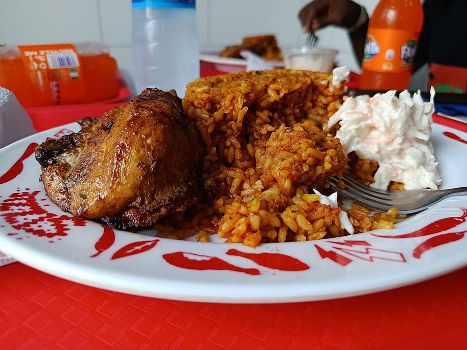

# West African Jollof Rice with Chicken

Photo: DebbieUfedo · CC BY-SA 4.0 · [source](https://commons.wikimedia.org/wiki/File:Nigerian_Jollof_02.jpg)

**Dinner** · Nigerian & West African · 60 min · serves 6 · skill 2/3

> Smoky, party-style jollof: rice cooked in a rich blended pepper-tomato sauce, served with seasoned roasted chicken.

| Per serving | kcal | Protein | Carbs | Fat | Fiber | Sodium | Cost |
| --- | --- | --- | --- | --- | --- | --- | --- |
| | 575 | 38 g | 66 g | 17 g | 5 g | 790 mg | $2.58 |

Contains: spicy

## Ingredients

- 2 lb chicken thighs
- 2 red bell peppers
- 4 Roma tomatoes
- 2 onions
- 1 scotch bonnet or jalapeño
- ¼ cup tomato paste or 1 cup crushed tomatoes
- 2½ cups long-grain parboiled rice
- 3 cups broth
- 4 garlic cloves
- 1-inch ginger

From the pantry: ⅓ cup oil, 2 tsp curry powder, 2 tsp thyme, 2 bay leaves, 1 bouillon cube, salt

## Steps

1. Rub the chicken with curry powder, thyme, garlic, ginger and salt. Roast at 425°F for 30 minutes.
2. Blend the peppers, tomatoes, 1 onion and the chili until smooth.
3. Fry the second onion (sliced) in the oil until soft, add the tomato paste and fry 3 minutes until darkened, then add the blended sauce. Simmer 15 minutes until reduced and the oil rises.
4. Stir in the rinsed rice, broth, bouillon, bay leaves, more curry and thyme. Cover tightly with foil and lid and cook on low 30 minutes.
5. Let the bottom catch slightly for that smoky 'party' flavor, then fluff and serve with the chicken.

**Tip:** Don't rush reducing the pepper sauce. Frying it down is where the flavor comes from.

## Storing

Fridge 5 days · freezer up to 3 months. Microwave covered with a splash of water.

## Other ways to make it

- Steak
- Shrimp
- Pork
- Tofu
