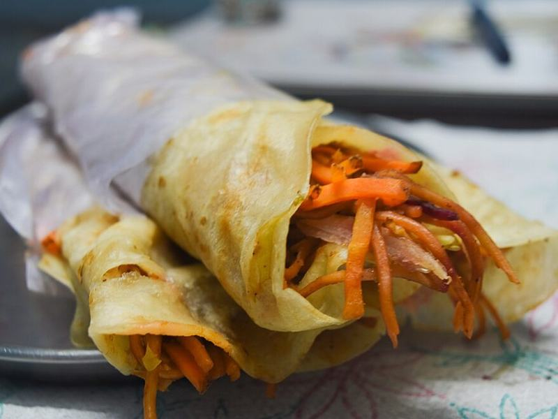

# Chicken Tikka Kathi Rolls with Mint Chutney

Photo: Satyajit Dhawale (Satyajit888) · CC BY-SA 4.0 · [source](https://commons.wikimedia.org/wiki/File:Kolkata_Rolls.jpg)

**Lunch** · Indian · 35 min · serves 4 · skill 2/3

> Kolkata street food: flaky paratha wrapped around smoky spiced chicken, lime-pickled onions and a bright mint-cilantro yogurt chutney.

| Per serving | kcal | Protein | Carbs | Fat | Fiber | Sodium | Cost |
| --- | --- | --- | --- | --- | --- | --- | --- |
| | 780 | 41 g | 69 g | 36 g | 4 g | 1100 mg | $3.74 |

Contains: gluten, dairy, spicy

## Ingredients

- 1¼ lb boneless chicken thighs, cut in strips
- 8 frozen parathas
- ¾ cup plain Greek yogurt, divided
- 1 tbsp garam masala
- 1 red onion, thinly sliced
- 2 limes, juiced
- 1 package mint leaves
- ½ bunch cilantro
- 1 jalapeño
- 2 garlic cloves, grated
- 1 tsp grated ginger

From the pantry: 1 tbsp oil, 1 tsp chili powder, 1 tsp ground cumin, ½ tsp turmeric, 1½ tsp salt

## Steps

1. Mix the chicken with ¼ cup of the yogurt, the garam masala, chili powder, cumin, turmeric, garlic, ginger and 1 tsp salt. Marinate 15 minutes or up to overnight.
2. Toss the onion with half the lime juice and a pinch of salt. Blend the mint, cilantro, jalapeño, the rest of the yogurt, the rest of the lime juice and a pinch of salt until smooth for the chutney.
3. Heat the oil in a large skillet over medium-high. Cook the chicken in a single layer, turning once, until charred at the edges and 165°F inside, 8 to 10 minutes total.
4. Cook the parathas in a dry skillet over medium heat until puffed and golden in spots, 1 to 2 minutes per side.
5. Spread each paratha with chutney, add a line of chicken and pickled onions, roll up tightly, and wrap the bottom in foil or parchment to hold it.

**Tip:** For a classic egg kathi roll, pour a beaten egg into the pan, set the paratha on top, and flip after 30 seconds so the egg cooks onto the bread.

## Storing

Fridge 3 days · freezer up to 2 months. Store the chicken, chutney and onions separately. Warm the chicken in a skillet 3 minutes and the parathas 1 minute per side, then roll fresh.

## Other ways to make it

- Steak
- Shrimp
- Pork
- Tofu
