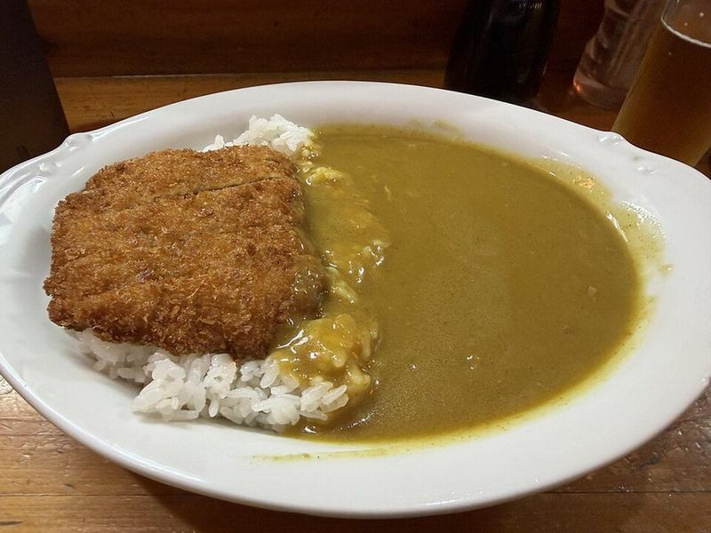

# Chicken Katsu Curry

Photo: Gatorfan252525 · CC BY-SA 4.0 · [source](https://commons.wikimedia.org/wiki/File:A_plate_of_Japanese_katsu_curry_in_Osaka,_Japan.jpg)

**Dinner** · Japanese · 45 min · serves 4 · skill 2/3

> Japanese comfort food: shatteringly crisp panko chicken cutlets over rice with a thick, mildly sweet curry gravy studded with potatoes and carrots.

| Per serving | kcal | Protein | Carbs | Fat | Fiber | Sodium | Cost |
| --- | --- | --- | --- | --- | --- | --- | --- |
| | 1030 | 55 g | 128 g | 32 g | 7 g | 1680 mg | $2.87 |

Contains: gluten, egg, dairy

## Ingredients

- 1½ lb chicken breasts, butterflied
- 2 eggs
- 2 cups panko
- ½ box (4 cubes) Japanese curry roux
- 1 onion, sliced
- 2 carrots, chunked
- 12 oz potatoes, chunked
- 2 cups short-grain or jasmine rice

From the pantry: ½ cup flour, oil for frying, salt

## Steps

1. Start the rice. Cook the onion in 1 tbsp oil until golden, 6 minutes. Add the carrots, potatoes and 3 cups water and simmer 15 minutes until tender.
2. Turn off the heat, add the roux cubes and stir until dissolved, then simmer 5 minutes until thick.
3. Season the chicken and dredge in flour, beaten egg and panko.
4. Fry in ½ inch of 350°F oil until deep golden, 3 to 4 minutes per side. Rest on a rack 3 minutes, then slice.
5. Serve rice and sliced katsu side by side with the curry spooned alongside.

**Tip:** Pickled ginger or a fried egg on top makes it feel like the real Tokyo curry-shop thing.

## Storing

Fridge 3 days · freezer up to 3 months. Freeze only the curry. Re-crisp katsu at 400°F for 8 minutes.

## Other ways to make it

- Steak
- Shrimp
- Pork
- Tofu
