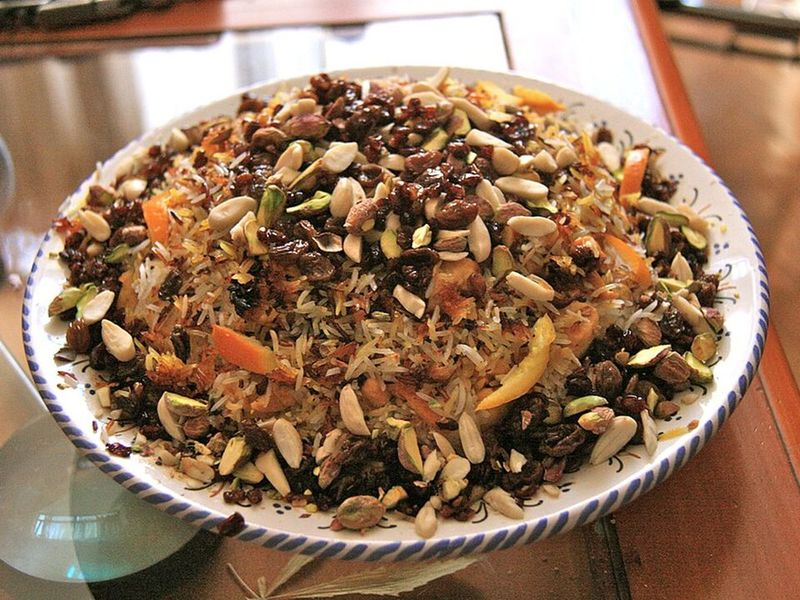

# Kenyan Beef Pilau with Kachumbari

Photo: Tamorlan · CC BY-SA 3.0 · [source](https://commons.wikimedia.org/wiki/File:Arroz_enjoyado_-_Morasa_Pol%C3%B3.JPG)

**Dinner** · Kenyan & East African · 90 min · serves 6 · skill 2/3

> Basmati rice cooked with tender beef, potatoes and deeply browned onions in a warm cumin-cardamom-clove masala, with a fresh tomato and onion kachumbari salad. Kenya's party rice.

| Per serving | kcal | Protein | Carbs | Fat | Fiber | Sodium | Cost |
| --- | --- | --- | --- | --- | --- | --- | --- |
| | 730 | 31 g | 89 g | 28 g | 6 g | 290 mg | $2.62 |

Contains: beef

## Ingredients

- 1½ lb beef chuck, in 1-inch cubes
- 2½ cups basmati rice, rinsed
- 3 onions (2 thinly sliced, 1 finely sliced for salad)
- 4 garlic cloves, minced
- 2 tbsp minced ginger
- 1 lb baby potatoes, halved
- 4 Roma tomatoes (2 diced for the pot, 2 for salad)
- ½ bunch cilantro, chopped
- 1 lemon
- 1 jalapeño, minced (optional, for salad)

From the pantry: ¼ cup oil, 2 tsp ground cumin, 1 tsp ground cardamom, 1 tsp black pepper, ¼ tsp ground cloves, 1 tsp paprika, 1 cinnamon stick, 2 beef bouillon cubes, salt

## Steps

1. Simmer the beef in 4 cups water with 1 tsp salt, covered, until nearly tender, 45 minutes. Strain, saving the broth (add water to make 4½ cups).
2. Heat the oil in a wide heavy pot over medium-high. Fry the 2 sliced onions, stirring often, until a deep, even brown, 12 to 15 minutes. This is what colors the rice.
3. Add the garlic, ginger, cumin, cardamom, pepper, cloves, paprika and cinnamon and fry 1 minute. Add the beef and brown it 5 minutes, then the diced tomatoes until they melt, 4 minutes.
4. Stir in the rice, potatoes, crumbled bouillon and the hot broth. Bring to a boil, cover tightly, reduce to low and cook 20 minutes. Rest off the heat 10 minutes, then fluff.
5. For the kachumbari, toss the remaining tomatoes and onion with cilantro, jalapeño, lemon juice and salt. Serve on the side of the pilau.

**Tip:** Kenyan shops sell ready-mixed pilau masala; 1½ tbsp replaces the ground spices here. Rinse the basmati until the water runs clear so the grains stay separate.

Adapted from [Kiano Moju via Tasty](https://tasty.co/recipe/kenyan-beef-and-potato-pilau-as-made-by-kiano-moju).

## Storing

Fridge 4 days · freezer up to 3 months. Sprinkle with a little water and microwave covered 2 minutes, or warm in a covered skillet over low. Make kachumbari fresh.

