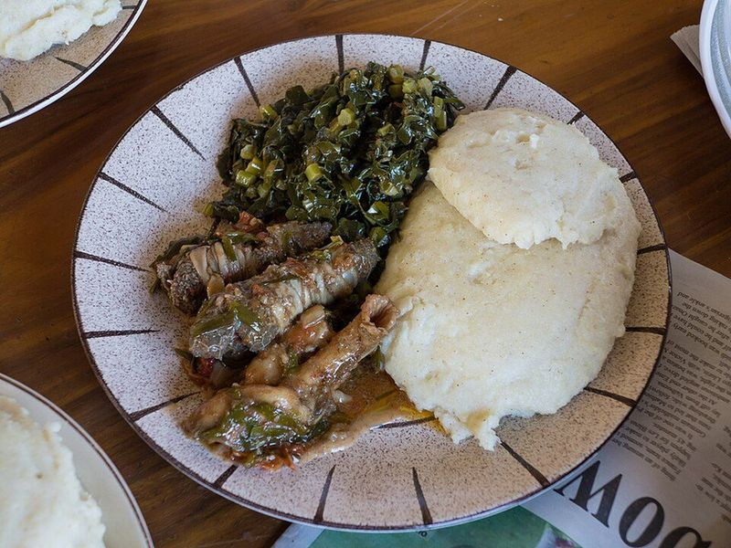

# Kenyan Wet-Fry Tilapia with Sukuma Wiki & Ugali

Photo: Tamuka Hwami · CC BY-SA 4.0 · [source](https://commons.wikimedia.org/wiki/File:Goat_Offal.JPG)

**Dinner** · Kenyan & East African · 50 min · serves 4 · skill 2/3

> Lake Victoria-style fried tilapia finished in a quick tomato and onion gravy, with garlicky sautéed greens and a firm, soft cornmeal ugali for scooping it all up.

| Per serving | kcal | Protein | Carbs | Fat | Fiber | Sodium | Cost |
| --- | --- | --- | --- | --- | --- | --- | --- |
| | 685 | 44 g | 90 g | 19 g | 13 g | 440 mg | $3.89 |

Contains: fish, gluten

## Ingredients

- 1½ lb tilapia fillets, in large pieces
- 2 onions, sliced
- 4 Roma tomatoes, chopped
- 1 green bell pepper, sliced
- 4 garlic cloves, minced
- ½ bunch cilantro, chopped
- 1 lemon
- 10 oz chopped kale or collards
- 2 cups white or fine yellow cornmeal

From the pantry: ¼ cup oil, 3 tbsp flour, 1 tsp paprika, 1 chicken bouillon cube, salt, pepper

## Steps

1. Season the fish with lemon juice, paprika, salt and pepper, then dust lightly with flour. Fry in 3 tbsp oil in a nonstick skillet over medium-high until golden, 2 to 3 minutes per side. Set aside.
2. In the same pan cook half the onions and the bell pepper 4 minutes, add half the garlic and the tomatoes with the bouillon and ½ cup water, and simmer until saucy, 8 minutes. Lay the fish in, spoon sauce over and simmer 3 minutes. Add cilantro.
3. For the ugali, bring 4 cups salted water to a boil, then whisk in half the cornmeal. Stir in the rest a little at a time with a wooden spoon, pressing out lumps, until very stiff and pulling from the sides. Cover and cook on low 5 to 8 minutes, then turn out onto a plate.
4. For the sukuma wiki, cook the remaining onions in 1 tbsp oil until soft, add the rest of the garlic and the greens with a splash of water and a pinch of salt, and cook until tender, 6 to 8 minutes.
5. Serve the fish and sauce with the greens and a wedge of ugali.

**Tip:** White maize meal is what Kenyans use for ugali; look for it at African or Latin markets (or use white grits ground fine). Yellow cornmeal tastes sweeter but works.

Adapted from [The Standard (Evewoman)](https://www.standardmedia.co.ke/evewoman/food/article/2000197366/kenyan-recipes-how-to-cook-the-best-fish).

## Storing

Fridge 2 days · freezer not recommended. Store fish and sides separately. Reheat fish in its sauce over low, 5 minutes. Slice leftover ugali and pan-fry until crisp.

