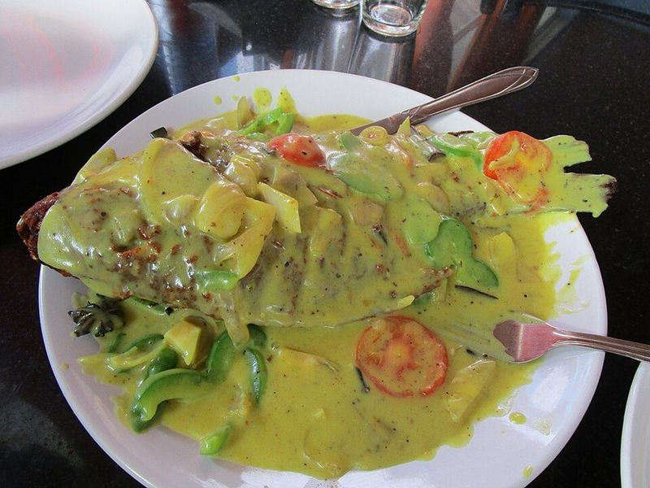

# Kerala Fish Molee (Coconut Milk Fish Stew)

Photo: Drsoumyadeepb · CC BY-SA 4.0 · [source](https://commons.wikimedia.org/wiki/File:Fish_Moilee_Kerala_Style_(aka_KeralaFish_Molly).JPG)

**Dinner** · South Indian & Goan · 40 min · serves 4 · skill 1/3

> A gentle, creamy Kerala stew: lightly fried white fish simmered in ginger- and pepper-scented coconut milk with green chilies, onions and tomato. Mild, aromatic and perfect over rice.

| Per serving | kcal | Protein | Carbs | Fat | Fiber | Sodium | Cost |
| --- | --- | --- | --- | --- | --- | --- | --- |
| | 900 | 41 g | 74 g | 51 g | 2 g | 420 mg | $3.55 |

Contains: fish

## Ingredients

- 1½ lb cod, halibut or other firm white fish, in large pieces
- 2 cans (13.5 oz) coconut milk
- 1 large onion, thinly sliced
- 2 Roma tomatoes, sliced
- 1-inch piece ginger, crushed
- 2 garlic cloves, crushed
- 2 to 3 green chilies, slit
- 1 lime
- 1½ cups rice

From the pantry: 2 tbsp oil (coconut oil is traditional), 1 tsp turmeric, 1 tsp black pepper, ½ tsp mustard seeds, 4 cloves, 3 green cardamom pods, 1 small cinnamon stick, 1 tbsp vinegar, 1 tsp salt

## Steps

1. Start the rice. Toss the fish with the turmeric, ½ tsp salt and the juice of the lime and rest 15 minutes. Open one can of coconut milk and mix it with 1 cup water for thin milk; keep the second can for finishing.
2. Heat the oil in a wide pan over medium-high and sear the fish until lightly golden, 1 to 2 minutes a side; it should still be underdone. Lift out gently.
3. In the same pan, add the mustard seeds, cloves, cardamom and cinnamon. When the seeds pop, add the ginger, garlic, onion and chilies and cook on medium until soft and translucent but not browned, 6 to 8 minutes. Add the tomato and pepper and cook 1 minute.
4. Pour in the thin coconut milk with the remaining salt and bring to a simmer. Slip in the fish and cook gently until it flakes, 4 to 5 minutes, shaking the pan rather than stirring.
5. Pour in the second can of coconut milk, warm through on low for 1 to 2 minutes without boiling, then turn off the heat and add the vinegar. Serve over rice.

**Tip:** Keep the heat low after adding the thick coconut milk so it doesn't split. In Kerala this is eaten with lacy appam, and two sprigs of curry leaves go in with the onions.

Adapted from [Kothiyavunu](https://www.kothiyavunu.com/wprm_print/fish-molee-meen-moliee-recipe-kerala-style-fish-stew).

## Storing

Fridge 2 days · freezer not recommended. Reheat gently over low heat; don't boil or the coconut milk may separate.

