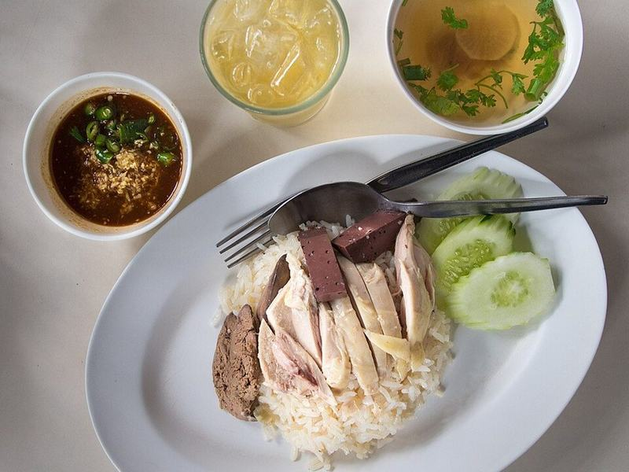

# Khao Man Gai (Thai Hainanese Chicken & Rice)

Photo: Takeaway · CC BY-SA 3.0 · [source](https://commons.wikimedia.org/wiki/File:2013_Khao_man_kai_CM.jpg)

**Dinner** · Thai · 60 min · serves 4 · skill 2/3

> Gently poached chicken over garlicky rice cooked in the poaching broth, served with cool cucumber, a cup of hot broth and a punchy ginger-chili-soy sauce. Simple, soothing and completely addictive.

| Per serving | kcal | Protein | Carbs | Fat | Fiber | Sodium | Cost |
| --- | --- | --- | --- | --- | --- | --- | --- |
| | 755 | 56 g | 89 g | 18 g | 3 g | 2060 mg | $3.52 |

Contains: gluten

## Ingredients

- 2 lb boneless chicken thighs
- 32 oz chicken broth
- 2-inch piece ginger: half sliced, half finely grated
- 8 garlic cloves: 4 smashed, 4 minced
- 4 green onions
- 2 cups jasmine rice, rinsed
- 2 tbsp white miso (stands in for fermented soybean paste)
- 3 tbsp soy sauce
- 1 jalapeño or 2 Thai chilies, minced
- 1 cucumber, sliced
- ½ bunch cilantro

From the pantry: 2 tbsp oil, 1 tbsp sugar, 2 tbsp rice vinegar, salt

## Steps

1. In a pot, bring the broth, 2 cups water, the sliced ginger, smashed garlic, green onions and 1 tsp salt to a simmer. Add the chicken, keep it at a bare simmer (no bubbles breaking) and poach until 170°F inside, 15 to 18 minutes. Move the chicken to a bowl of cold water for 2 minutes so it stays juicy, then set it aside.
2. Heat the oil in a saucepan over medium. Fry the minced garlic until pale gold, 1 minute, then add the rinsed rice and stir until it smells toasty, 2 minutes. Add 3 cups of the strained poaching broth and ½ tsp salt, bring to a boil, cover and cook on low for 15 minutes. Rest 10 minutes off the heat.
3. For the sauce, stir the miso, soy sauce, grated ginger, chili, sugar, vinegar and 1 tbsp hot broth until smooth.
4. Reheat the remaining broth and season it with salt. Slice the chicken.
5. Mound the rice on plates and top with sliced chicken, cucumber and cilantro. Serve each plate with a small bowl of hot broth and the sauce for spooning over.

**Tip:** Keep the poaching water barely trembling. Boiling squeezes the moisture out of the chicken and makes it stringy.

## Storing

Fridge 3 days · freezer up to 2 months. Keep chicken, rice and broth separate. Microwave the rice and chicken covered with a spoonful of broth, and heat the broth on the stove.

## Other ways to make it

- Steak
- Shrimp
- Pork
- Tofu
