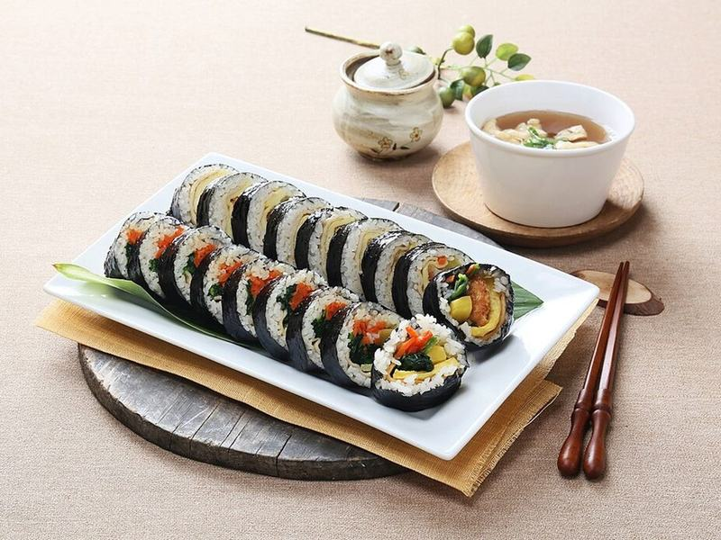

# Korean Beef Kimbap

Photo: changupn · CC0 · [source](https://commons.wikimedia.org/wiki/File:Gimbap_(pixabay).jpg)

**Lunch** · Korean · 60 min · serves 4 · skill 3/3

> Sesame-seasoned rice rolled in seaweed around soy-garlic beef, egg ribbons, spinach, carrot and tangy yellow radish. Every slice is a complete bite, and it's made to be packed.

| Per serving | kcal | Protein | Carbs | Fat | Fiber | Sodium | Cost |
| --- | --- | --- | --- | --- | --- | --- | --- |
| | 680 | 26 g | 82 g | 27 g | 4 g | 1100 mg | $2.89 |

Contains: gluten, sesame, egg, beef

## Ingredients

- 2 cups short-grain rice
- 5 nori sheets
- 8 oz shaved steak, chopped
- 3 eggs
- 6 oz baby spinach
- 2 carrots, cut in matchsticks
- 5 strips yellow pickled radish
- 2 tbsp soy sauce
- 2 garlic cloves, minced
- 2 tbsp sesame seeds

From the pantry: 3 tbsp sesame oil, 1 tbsp oil, 2 tsp sugar, 1 tsp salt

## Steps

1. Cook the rice with 2¼ cups water. While it is warm, gently fold in 1½ tbsp sesame oil, ½ tsp salt and 1 tbsp sesame seeds. Cover with a damp towel.
2. Toss the beef with the soy, sugar, garlic and 1 tsp sesame oil, then cook in a hot skillet over medium-high until browned and the liquid is gone, 3 to 4 minutes. Set aside.
3. Beat the eggs with a pinch of salt and cook in the oiled skillet over medium-low as a thin omelet, covered, until set, 2 to 3 minutes. Roll it up and slice into long strips. Stir-fry the carrots until just tender, 2 minutes.
4. Blanch the spinach in boiling water for 20 seconds, rinse cold, squeeze dry and toss with ½ tsp salt and the rest of the sesame oil except 1 tsp.
5. Lay a nori sheet shiny side down on a bamboo mat or a sheet of plastic wrap. Spread a thin layer of rice over it, leaving a 1-inch strip bare at the top. Line beef, egg, spinach, carrot and radish across the middle.
6. Roll tightly away from you, pressing as you go, and seal the bare edge with a few grains of rice. Brush with the last sesame oil, sprinkle with the remaining seeds, and slice into ½-inch rounds with a wet, sharp knife.

**Tip:** Keep the rice layer thin, about two grains deep. Too much rice is the main reason kimbap won't close or falls apart when sliced.

## Storing

Fridge 1 days · freezer not recommended. Best the day it's made. Chilled rice hardens, so dip leftover slices in beaten egg and pan-fry 1 to 2 minutes per side.

## Other ways to make it

- Chicken
- Shrimp
- Pork
- Tofu
