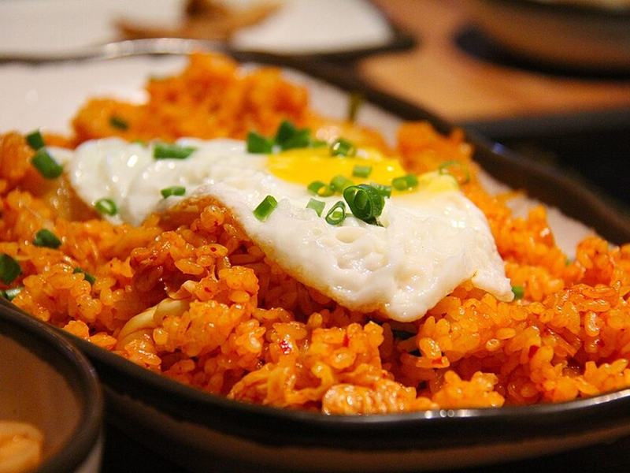

# Kimchi Fried Rice with Fried Eggs

Photo: Sharon Ang · CC0 · [source](https://commons.wikimedia.org/wiki/File:Kimchi_fried_rice.jpg)

**Dinner** · Korean · 20 min · serves 4 · skill 1/3

> Day-old rice fried with tangy kimchi, crispy bacon and gochujang, topped with runny-yolk fried eggs.

| Per serving | kcal | Protein | Carbs | Fat | Fiber | Sodium | Cost |
| --- | --- | --- | --- | --- | --- | --- | --- |
| | 450 | 18 g | 56 g | 17 g | 3 g | 1360 mg | $3.05 |

Contains: egg, gluten, sesame, spicy, pork

## Ingredients

- 4 cups cooked day-old rice
- 1½ cups kimchi, chopped, plus 3 tbsp juice
- 6 slices bacon (or Spam), chopped
- 1 to 2 tbsp gochujang
- 4 eggs
- 4 green onions
- sesame seeds

From the pantry: 1 tbsp butter, 1 tsp sesame oil, 1 tbsp soy sauce

## Steps

1. Cook the bacon until crisp in a large skillet. Leave the fat in the pan.
2. Add the kimchi and cook 3 minutes until it starts to caramelize.
3. Add the rice, kimchi juice, gochujang and soy and toss over high heat, pressing the rice into the pan to crisp, 5 minutes.
4. Stir in the butter, sesame oil and most of the green onions.
5. Fry the eggs and serve on top with sesame and the rest of the green onions.

**Tip:** Older, sour kimchi makes the best fried rice.

## Storing

Fridge 4 days · freezer up to 2 months. Reheat in a hot skillet. Fry a fresh egg.

