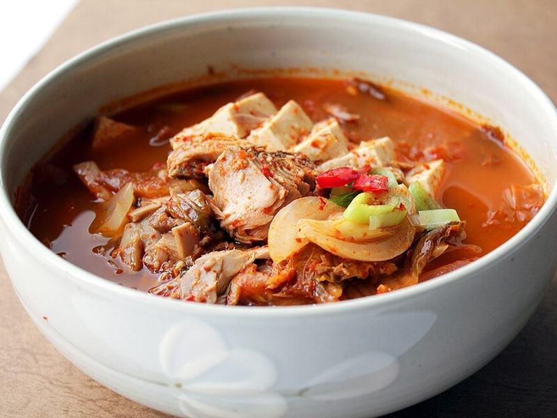

# Kimchi Jjigae with Pork & Tofu

Photo: Chloe Lim · CC BY 2.0 · [source](https://commons.wikimedia.org/wiki/File:Tuna_kimchi-jjigae.jpg)

**Dinner** · Korean · 40 min · serves 4 · skill 1/3

> A bubbling, sour-spicy stew of well-aged kimchi, rich pork and soft tofu. Korean home cooks make it whenever the kimchi gets funky, and it warms you right through.

| Per serving | kcal | Protein | Carbs | Fat | Fiber | Sodium | Cost |
| --- | --- | --- | --- | --- | --- | --- | --- |
| | 650 | 32 g | 72 g | 26 g | 5 g | 1260 mg | $3.34 |

Contains: pork, gluten, sesame, spicy

## Ingredients

- 2 cups (16 oz) ripe kimchi, chopped, plus its juice
- ¾ lb pork shoulder, thinly sliced
- 14 oz tofu, in ½-inch slices
- 1 onion, sliced
- 3 garlic cloves, minced
- 2 tbsp gochujang
- 4 green onions, sliced
- 1½ cups short-grain or jasmine rice

From the pantry: 1 tbsp gochugaru or ½ tsp red pepper flakes, 1 tsp sugar, 1 tbsp oil, 1 tsp sesame oil, salt

## Steps

1. Start the rice. Heat the oil and sesame oil in a medium pot over medium-high heat. Add the pork and cook, stirring, until no longer pink and starting to brown, 3 to 4 minutes.
2. Add the kimchi and the onion and stir-fry until the kimchi softens and smells toasty, 4 to 5 minutes.
3. Stir in the garlic, gochujang, gochugaru and sugar, then add ¼ cup kimchi juice and 3 cups water. Bring to a boil, then cover and simmer 15 minutes so the pork turns tender and the broth deepens.
4. Lay the tofu slices on top, spoon broth over them and simmer 5 minutes more, until heated through. Taste and add salt or more kimchi juice if it needs more tang.
5. Scatter with green onions and bring the pot to the table bubbling, with bowls of rice.

**Tip:** Older, really sour kimchi makes the best jjigae. If yours is fresh, add 1 tsp rice vinegar to brighten the broth.

## Storing

Fridge 4 days · freezer up to 3 months. Simmer on the stove until bubbling. It tastes even better the next day.

## Other ways to make it

- Chicken
- Steak
- Shrimp
- Pork
