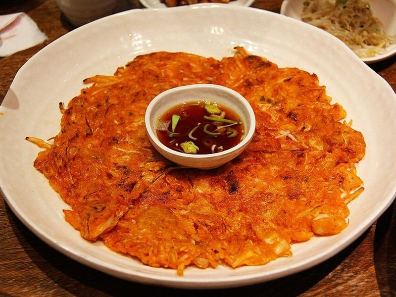

# Crispy Kimchi Pancakes (Kimchijeon) with Fried Eggs

Photo: sharonang · CC0 · [source](https://commons.wikimedia.org/wiki/File:Kimchibuchimgae_(kimchi_pancake).jpg)

**Breakfast** · Korean · 30 min · serves 4 · skill 1/3

> Lacy-edged, crunchy pancakes packed with tangy, well-fermented kimchi, scallions and onion, fried in plenty of oil and topped with a runny fried egg, with a vinegary soy sauce for dunking. It's a great way to use up sour kimchi.

| Per serving | kcal | Protein | Carbs | Fat | Fiber | Sodium | Cost |
| --- | --- | --- | --- | --- | --- | --- | --- |
| | 370 | 13 g | 28 g | 24 g | 3 g | 980 mg | $1.75 |

Contains: gluten, egg, spicy, sesame

## Ingredients

- 1½ cups well-fermented kimchi, chopped, plus ¼ cup of its juice
- 4 green onions, in 2-inch pieces
- ½ small onion, thinly sliced
- 5 eggs (1 for the batter, 4 to fry)
- 2 tsp gochujang
- 2 tbsp soy sauce
- 1 tbsp sesame seeds

From the pantry: 1½ cups flour, 1 cup ice-cold water, 6 tbsp oil, 2 tsp rice vinegar, 1 tsp sugar, pinch black pepper

## Steps

1. Stir the soy, vinegar, sugar, pepper, sesame seeds and 1 tbsp water together for the dipping sauce.
2. In a large bowl, whisk the gochujang into the cold water with the kimchi juice and egg. Add the flour and stir just until combined; a few lumps are fine. It should flow easily from a spoon.
3. Fold in the kimchi, green onions and onion.
4. Heat 1½ tbsp oil in a large nonstick skillet over medium-high. Ladle in a quarter of the batter and spread it into a thin round. Cook until the edges are golden and crisp, 3 to 4 minutes.
5. Flip, add a little more oil around the edges and swirl the pan, then cook until crisp and cooked through, 2 to 3 minutes more. Repeat with the rest and keep warm in a low oven.
6. Fry the 4 eggs in the same pan with a little oil until the whites are set and the yolks still runny, 2 to 3 minutes. Serve each pancake in wedges topped with an egg, with the sauce.

**Tip:** Sour, older kimchi gives the best flavor, and ice-cold water keeps the pancakes crisp. Korean buchimgaru pancake mix makes them even crunchier.

Adapted from [Korean Bapsang](https://www.koreanbapsang.com/kimchi-jeon-kimchi-pancake).

## Storing

Fridge 2 days · freezer up to 1 months. Re-crisp in a dry skillet over medium for 2 minutes per side, or in an air fryer at 375°F for 4 minutes.

