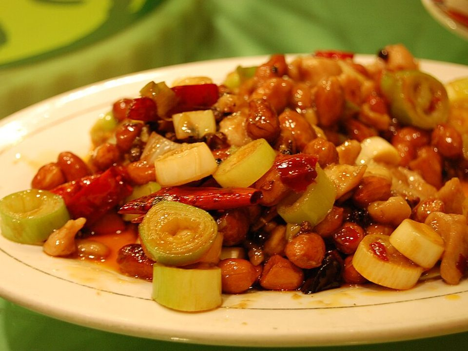

# Kung Pao Chicken

Photo: Steven G. Johnson · CC BY-SA 3.0 · [source](https://commons.wikimedia.org/wiki/File:Kung-pao-shanghai.jpg)

**Dinner** · Sichuan & Hunan · 25 min · serves 4 · skill 2/3

> Juicy chicken, crunchy peanuts and peppers in a tingly, sweet-sour-spicy sauce. Faster than ordering and far less greasy.

| Per serving | kcal | Protein | Carbs | Fat | Fiber | Sodium | Cost |
| --- | --- | --- | --- | --- | --- | --- | --- |
| | 730 | 47 g | 72 g | 29 g | 6 g | 1040 mg | $2.76 |

Contains: gluten, nuts, spicy

## Ingredients

- 1½ lb boneless thighs, cubed
- 2 bell peppers, chunked
- ⅔ cup roasted peanuts
- ¼ cup soy sauce
- 2 tbsp honey
- 4 garlic cloves
- 1-inch ginger
- 6 green onions, in 1-inch pieces
- 1½ cups rice

From the pantry: 2 tbsp cornstarch, 2 tbsp rice vinegar, 8 dried chilies or 1 tsp chili flakes, 2 tbsp oil, 1 tsp Sichuan peppercorns (optional)

## Steps

1. Toss the chicken with 1 tbsp soy and 1 tbsp cornstarch. Start the rice.
2. Whisk the remaining soy, honey, vinegar, 1 tbsp cornstarch and 3 tbsp water.
3. Stir-fry the chicken in the oil over high heat until browned, 5 minutes. Add the chilies, peppercorns, garlic and ginger for 30 seconds.
4. Add the peppers and green onions and cook 2 minutes.
5. Add the sauce and peanuts and toss until glossy. Serve over rice.

**Tip:** Sichuan peppercorns give the famous numbing tingle. Find them in the spice aisle.

## Storing

Fridge 4 days · freezer up to 2 months. Reheat in a skillet over medium with a splash of water until hot, 3 to 5 minutes.

## Other ways to make it

- Steak
- Shrimp
- Pork
- Tofu
