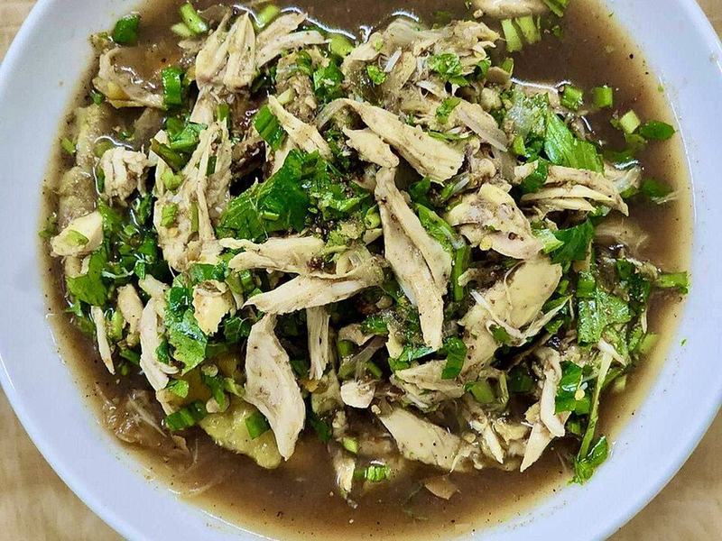

# Thai Chicken Larb with Sticky Rice

Photo: Bounthy · CC BY-SA 4.0 · [source](https://commons.wikimedia.org/wiki/File:Lao_Sua_Gai_(Sua_Chicken).jpg)

**Lunch** · Thai · 40 min · serves 4 · skill 2/3

> Juicy minced chicken tossed with lime, fish sauce, chiles, a fistful of herbs and nutty toasted rice powder, scooped up with sticky rice and crisp lettuce.

| Per serving | kcal | Protein | Carbs | Fat | Fiber | Sodium | Cost |
| --- | --- | --- | --- | --- | --- | --- | --- |
| | 525 | 35 g | 73 g | 10 g | 6 g | 920 mg | $2.92 |

Contains: fish, spicy

## Ingredients

- 1¼ lb boneless chicken thighs, finely chopped (or ground chicken)
- 1½ cups glutinous rice, plus 2 tbsp for toasting
- 3 tbsp fish sauce
- 4 limes, juiced
- ½ red onion, thinly sliced
- 1 package fresh mint, leaves picked
- ½ bunch cilantro, chopped
- 4 green onions, sliced
- 1 romaine heart, leaves separated
- ½ cucumber, sliced

From the pantry: 1 tbsp oil, 1 tsp sugar, 1 to 2 tsp chili flakes

## Steps

1. Soak the 1½ cups sticky rice in cold water for at least 30 minutes (or overnight). Drain and steam in a cheesecloth-lined steamer basket over boiling water until chewy and translucent, 20 to 25 minutes.
2. Toast the extra 2 tbsp of dry rice in a dry skillet over medium heat, shaking often, until deep golden, 5 to 6 minutes. Cool, then grind to a coarse powder in a spice grinder or mortar.
3. Cook the chicken with the oil and 3 tbsp water in a skillet over medium heat, breaking it up, until cooked through and no longer pink, 5 to 6 minutes. Let cool for 2 minutes.
4. Toss the warm chicken with the fish sauce, lime juice, sugar, chili flakes and red onion, then fold in the herbs and 1½ tbsp of the rice powder. Taste: it should be sour, salty and spicy.
5. Sprinkle with the remaining rice powder and serve with the sticky rice, lettuce leaves and cucumber.

**Tip:** No steamer? Microwave the soaked, drained rice with ½ cup water in a covered bowl for 3 minutes, stir, then cook in 2-minute bursts until translucent.

## Storing

Fridge 2 days · freezer not recommended. Pack the herbs and toasted rice separately. Eat the larb cold or at room temperature. Microwave sticky rice under a damp paper towel for 1 minute to soften it.

## Other ways to make it

- Steak
- Shrimp
- Pork
- Tofu
