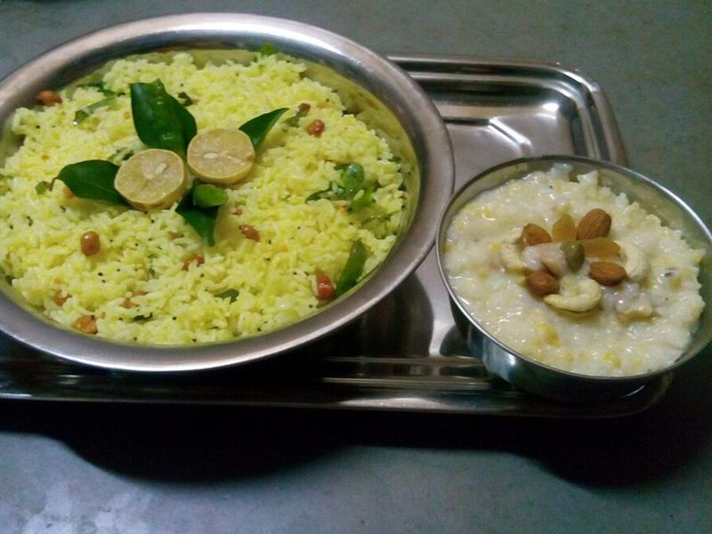

# Lemon Rice (Chitranna) with Peanuts & Cucumber Raita

Photo: Radhikapavan · CC BY-SA 4.0 · [source](https://commons.wikimedia.org/wiki/File:Chitranna_and_Payasa.jpg)

**Lunch** · South Indian & Goan · 30 min · serves 4 · skill 1/3

> Bright, tangy turmeric-yellow rice from Karnataka and Tamil Nadu, tossed with a crackling tempering of mustard seeds, chilies and ginger, lots of fresh lemon and crunchy peanuts and cashews. A cool yogurt raita on the side.

| Per serving | kcal | Protein | Carbs | Fat | Fiber | Sodium | Cost |
| --- | --- | --- | --- | --- | --- | --- | --- |
| | 625 | 21 g | 91 g | 20 g | 3 g | 420 mg | $1.35 |

Contains: nuts, dairy

## Ingredients

- 2 cups basmati rice (or 6 cups cooked, cooled rice)
- ⅓ cup roasted peanuts
- ¼ cup cashews
- 2 to 3 lemons
- 1 tbsp minced ginger
- 1 to 2 green chilies, slit
- chopped cilantro
- 1½ cups plain yogurt
- ½ cucumber, grated

From the pantry: 3 tbsp oil, 1 tsp mustard seeds, 2 dried red chilies, ½ tsp turmeric, 1¼ tsp salt, 1 pinch asafoetida (optional), ½ tsp ground cumin

## Steps

1. Cook the rice so the grains stay separate, then spread it on a tray to cool completely, about 15 minutes.
2. Heat the oil in a large skillet over medium. Fry the cashews and peanuts until golden, 1 to 2 minutes, and lift them out.
3. Add the mustard seeds to the oil and, when they pop, the dried chilies, green chilies, ginger and asafoetida. Fry 30 seconds, then stir in the turmeric and ¾ tsp salt and turn off the heat.
4. Add the cooled rice and the juice of 2 lemons and toss gently until every grain is yellow. Taste and add more salt or lemon; it should be noticeably tangy. Fold in the nuts and cilantro.
5. Stir the yogurt with the cucumber, cumin and ½ tsp salt. Serve the rice warm or at room temperature with the raita.

**Tip:** Using day-old rice gives the best texture. A sprig of fresh curry leaves fried with the mustard seeds, and a spoonful of chana dal, make it taste just like a South Indian home kitchen.

Adapted from [Swasthi's Recipes](https://www.indianhealthyrecipes.com/lemon-rice-recipe/).

## Storing

Fridge 3 days · freezer not recommended. Lemon rice is traditionally packed for travel and lunchboxes; eat it at room temperature or warm it briefly.

