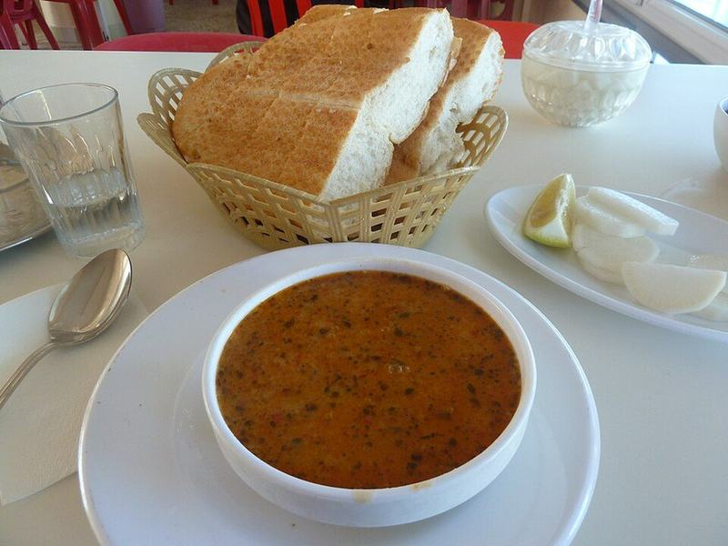

# Lebanese Red Lentil Soup with Lemon & Crispy Pita

Photo: Matt Krause from Istanbul, Turkey · CC BY 2.0 · [source](https://commons.wikimedia.org/wiki/File:Ezogelin_soup,_bread,_and_water.jpg)

**Lunch** · Lebanese & Levantine · 40 min · serves 6 · skill 1/3

> A velvety, cumin-scented soup of red lentils and sweet onions, brightened with plenty of lemon and topped with crisp toasted pita. Cheap, filling and better the next day.

| Per serving | kcal | Protein | Carbs | Fat | Fiber | Sodium | Cost |
| --- | --- | --- | --- | --- | --- | --- | --- |
| | 570 | 25 g | 90 g | 12 g | 12 g | 540 mg | $0.99 |

Contains: gluten

## Ingredients

- 2⅓ cups (1 lb) red lentils, rinsed
- 2 onions, chopped
- 2 carrots, chopped
- 4 garlic cloves, minced
- 2 lemons, juiced, plus wedges
- ½ bunch parsley, chopped
- 6 pitas, cut into wedges

From the pantry: 5 tbsp olive oil, 2 tsp ground cumin, ½ tsp turmeric, ¼ tsp cayenne, 2 tsp salt, ½ tsp pepper

## Steps

1. Heat 3 tbsp oil in a large pot over medium heat. Add the onions, carrots and a pinch of salt and cook until soft and golden at the edges, 8 to 10 minutes. Stir in the garlic, cumin, turmeric and cayenne for 30 seconds.
2. Add the lentils, 9 cups water, the salt and pepper. Bring to a boil, then simmer partly covered, stirring now and then, until the lentils fall apart, 20 to 25 minutes.
3. Meanwhile, toss the pita wedges with the remaining 2 tbsp oil and bake at 400°F until crisp and golden, 8 to 10 minutes.
4. Purée the soup with an immersion blender until smooth, adding water if it's thicker than heavy cream. Stir in the lemon juice and taste for salt.
5. Ladle into bowls and top with parsley, a drizzle of olive oil and the crispy pita, with lemon wedges on the side.

**Tip:** Be generous with the lemon. The acid lifts the earthy lentils, so taste and keep adding until the soup tastes bright.

## Storing

Fridge 5 days · freezer up to 3 months. The soup thickens as it sits. Reheat on the stove with a splash of water, stirring, until simmering. Keep the pita chips in a sealed bag at room temperature.

