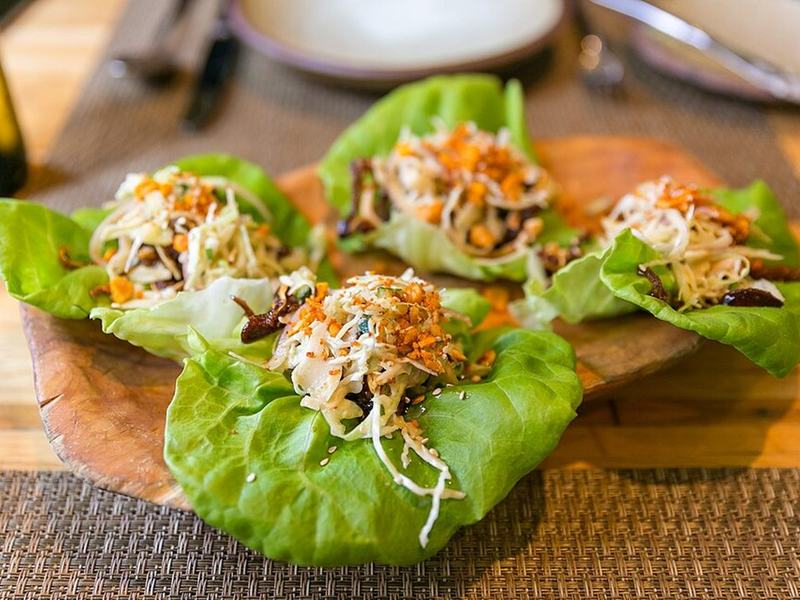

# Chicken Lettuce Wraps with Shiitakes & Water Chestnuts

Photo: City Foodsters · CC BY 2.0 · [source](https://commons.wikimedia.org/wiki/File:Kentuckyaki_Pig%E2%80%99s_Ear_Lettuce_Wraps,_Cabbage_and_Red_Onion_%E2%80%9CSlaw,%E2%80%9D_-_Toasted_Peanuts,_Cucumber-Lime_Dressing_(15383076453).jpg)

**Lunch** · Chinese & Cantonese · 25 min · serves 4 · skill 1/3

> The restaurant favorite at home: savory hoisin-glazed chicken with crunchy water chestnuts and shiitakes, spooned into cool butter lettuce cups with a little rice.

| Per serving | kcal | Protein | Carbs | Fat | Fiber | Sodium | Cost |
| --- | --- | --- | --- | --- | --- | --- | --- |
| | 520 | 39 g | 58 g | 14 g | 4 g | 980 mg | $4.07 |

Contains: gluten, sesame

## Ingredients

- 1¼ lb chicken breast, finely chopped (or 1¼ lb ground turkey)
- 5 oz shiitake mushrooms, stems removed, diced
- 1 can sliced water chestnuts, drained and chopped
- 2 heads butter lettuce, leaves separated
- 4 green onions, sliced
- 4 garlic cloves, minced
- 1 tbsp grated fresh ginger
- ⅓ cup hoisin sauce
- 2 tbsp soy sauce
- 1 cup jasmine rice

From the pantry: 2 tbsp oil, 1 tbsp rice vinegar, 2 tsp sesame oil, 1 tsp sugar, 1 tsp cornstarch, salt

## Steps

1. Cook the rice. Stir the hoisin, soy, vinegar, sesame oil, sugar and cornstarch with 2 tbsp water for the sauce.
2. Heat the oil in a large skillet over high heat. Add the chicken in an even layer and cook without stirring for 2 minutes, then stir and cook until no longer pink, 2 to 3 minutes more.
3. Add the shiitakes and cook until they soften and the pan looks dry, 3 minutes. Stir in the garlic, ginger and white parts of the green onions for 30 seconds.
4. Add the water chestnuts and sauce and toss until the sauce thickens and coats everything, about 1 minute. Taste and add a pinch of salt if needed.
5. Spoon a little rice and the filling into the lettuce cups, top with green onion tops, and eat with your hands.

**Tip:** Chop the chicken into pieces the size of a pea. They brown faster and stay juicier than store-bought ground chicken.

## Storing

Fridge 3 days · freezer up to 2 months. Store the filling apart from the lettuce. Microwave the filling 1 to 1½ minutes, or pack it cold with the lettuce on the side.

## Other ways to make it

- Steak
- Shrimp
- Pork
- Tofu
