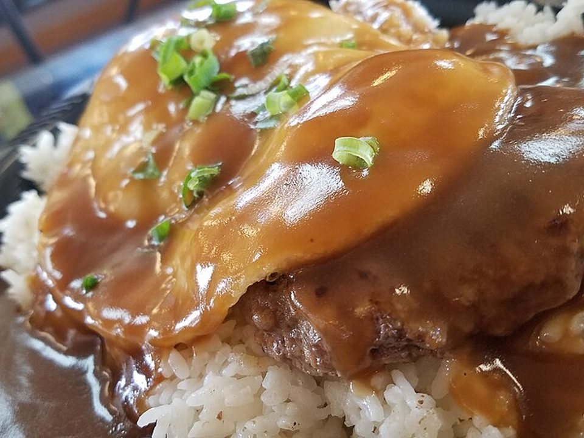

# Loco Moco

Photo: California Cow from Seattle, USA · CC BY 2.0 · [source](https://commons.wikimedia.org/wiki/File:Loco_moco_(32605169782).jpg)

**Dinner** · Hawaiian · 30 min · serves 4 · skill 1/3

> The ultimate Hawaiian plate lunch: rice topped with a juicy burger patty, rich onion gravy and a runny fried egg.

| Per serving | kcal | Protein | Carbs | Fat | Fiber | Sodium | Cost |
| --- | --- | --- | --- | --- | --- | --- | --- |
| | 780 | 38 g | 54 g | 45 g | 2 g | 1160 mg | $2.51 |

Contains: beef, egg, gluten

## Ingredients

- 1⅓ lb ground beef
- 1 onion, sliced
- 2 cups beef broth
- 4 eggs
- 1½ cups rice
- green onions
- 1 tbsp soy sauce

From the pantry: 2 tbsp butter, 2 tbsp flour, 1 tbsp Worcestershire, salt, pepper, 1 tbsp oil

## Steps

1. Cook the rice. Shape the beef into 4 patties, season, and sear 4 minutes per side. Move to a plate.
2. In the same pan, cook the onion in the butter until golden, 6 minutes.
3. Stir in the flour for 1 minute, then whisk in the broth, soy and Worcestershire. Simmer until thick, 3 minutes. Season.
4. Fry the eggs in the oil.
5. Layer rice, a patty, plenty of gravy and an egg. Top with green onions.

**Tip:** Serve with a scoop of macaroni salad for the full plate-lunch experience.

## Storing

Fridge 3 days · freezer up to 3 months. Store patties in gravy. Reheat covered and fry a fresh egg.

## Other ways to make it

- Ground turkey
- Ground pork
- Italian sausage
- Lentils (veg)
