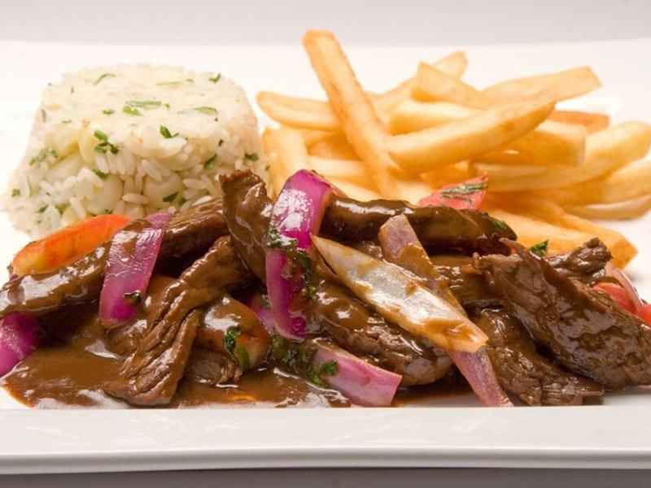

# Peruvian Lomo Saltado (Beef & Potato Stir-Fry)

Photo: WikiHes · CC BY-SA 4.0 · [source](https://commons.wikimedia.org/wiki/File:Lomo-saltado-perudelights.jpg)

**Dinner** · Peruvian · 45 min · serves 4 · skill 2/3

> A sizzling Peruvian-Chinese stir-fry of soy-glazed steak, red onion and juicy tomatoes tossed with crispy oven fries and served with rice, so every bite gets some of the sauce.

| Per serving | kcal | Protein | Carbs | Fat | Fiber | Sodium | Cost |
| --- | --- | --- | --- | --- | --- | --- | --- |
| | 760 | 49 g | 80 g | 28 g | 7 g | 1000 mg | $4.46 |

Contains: gluten, beef, spicy

## Ingredients

- 1½ lb sirloin, in thick strips
- 1½ lb russet potatoes, cut in fries
- 1 large red or yellow onion, in thick wedges
- 4 Roma tomatoes, in wedges
- 2 jalapeños (or ají amarillo), in strips
- 4 garlic cloves, minced
- ¼ cup soy sauce
- 1 cup rice
- cilantro, chopped

From the pantry: 5 tbsp oil, 2 tbsp red wine vinegar, 1 tsp ground cumin, 1 tsp salt, ½ tsp black pepper

## Steps

1. Heat the oven to 450°F. Toss the fries with 2 tbsp oil and ½ tsp salt and roast on a sheet pan, flipping once, until golden and crisp, 30 to 35 minutes. Start the rice.
2. Season the beef with the cumin, pepper and remaining salt. Heat 1 tbsp oil in a wok or large skillet over high until smoking and sear the beef in two batches until browned but still pink inside, 1 to 2 minutes per batch. Move to a plate.
3. Add the remaining oil and the onion and jalapeños and stir-fry for 2 minutes, until the onion is charred at the edges but still crisp. Add the garlic for 30 seconds.
4. Add the soy sauce and vinegar (it will sizzle), then return the beef with the tomatoes and toss just until the tomatoes soften slightly, 1 minute.
5. Turn off the heat, toss in the fries and cilantro and serve right away with rice.

**Tip:** Keep the pan very hot and work fast. The tomatoes should barely wilt, and the fries go in at the very end so they stay crisp.

## Storing

Fridge 2 days · freezer not recommended. Reheat in a hot skillet for 3 to 4 minutes. The fries will soften, so re-crisp them in a 425°F oven if you can.

## Other ways to make it

- Chicken
- Shrimp
- Pork
- Tofu
