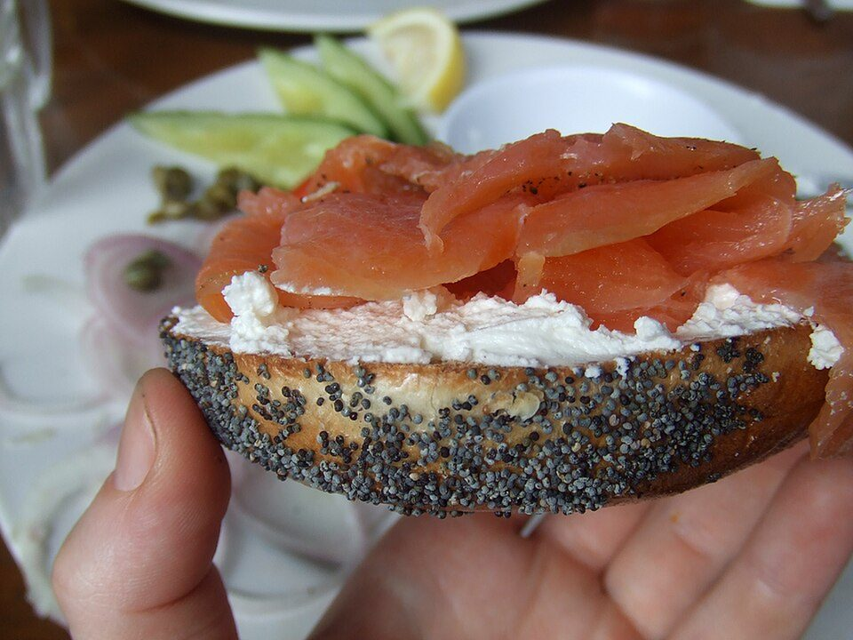

# Everything Bagels with Lox & Cream Cheese

Photo: Helen Cook · CC BY-SA 2.0 · [source](https://commons.wikimedia.org/wiki/File:*this*_is_a_bagel.jpg)

**Breakfast** · American comfort · 10 min · serves 4 · skill 1/3

> The New York deli classic: toasted bagels with whipped cream cheese, silky smoked salmon, cucumber, red onion and a shake of everything seasoning.

| Per serving | kcal | Protein | Carbs | Fat | Fiber | Sodium | Cost |
| --- | --- | --- | --- | --- | --- | --- | --- |
| | 565 | 26 g | 62 g | 24 g | 3 g | 1960 mg | $3.79 |

Contains: fish, dairy, gluten, sesame

## Ingredients

- 4 bagels
- 8 oz cream cheese, softened
- 8 oz smoked salmon
- ½ cucumber, thinly sliced
- thin red onion slices
- ½ lemon
- everything bagel seasoning

From the pantry: Capers and fresh dill (optional), black pepper

## Steps

1. Whip the cream cheese with a squeeze of lemon and some pepper until fluffy.
2. Split and toast the bagels.
3. Spread generously with cream cheese.
4. Layer on cucumber, smoked salmon and a few onion slices.
5. Finish with everything seasoning, capers and dill.

**Tip:** Soak the onion slices in ice water for 5 minutes to make them milder and extra crisp.

## Storing

Fridge 0 days · freezer not recommended. Assemble fresh. Smoked salmon keeps 5 days once opened.

