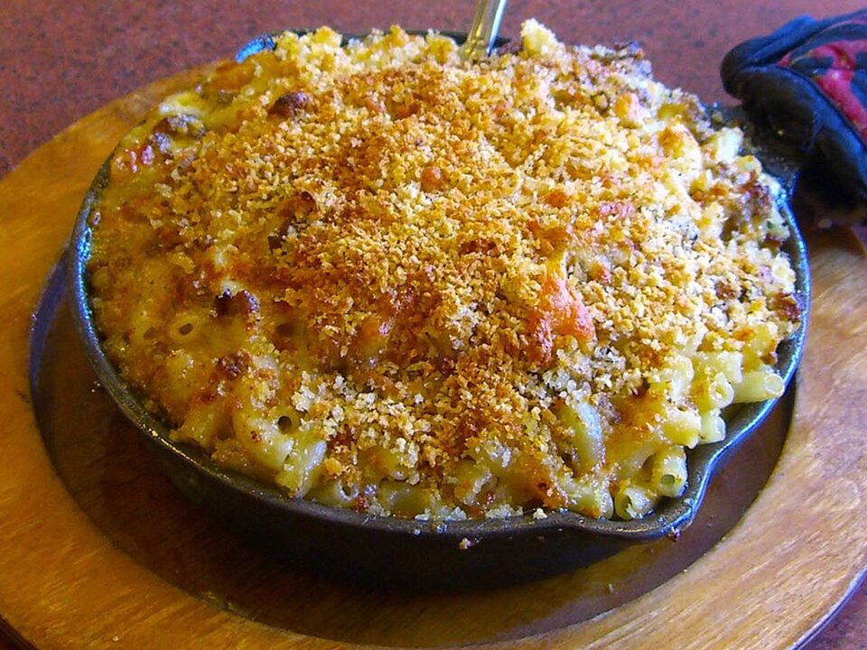

# Crispy-Top Baked Mac & Cheese

Photo: Luigi Novi · CC BY 3.0 · [source](https://commons.wikimedia.org/wiki/File:8.28.12CheeseburgerMacByLuigiNovi1.jpg)

**Dinner** · American comfort · 45 min · serves 6 · skill 1/3

> Elbows in a sharp, extra-creamy cheddar sauce baked under buttery panko until golden and crunchy. Serve with roasted broccoli for a full meal.

| Per serving | kcal | Protein | Carbs | Fat | Fiber | Sodium | Cost |
| --- | --- | --- | --- | --- | --- | --- | --- |
| | 865 | 38 g | 78 g | 46 g | 5 g | 940 mg | $1.65 |

Contains: dairy, gluten

## Ingredients

- 1 lb elbow macaroni
- 5 tbsp butter, divided
- 3 cups milk
- 4 cups shredded sharp cheddar
- 4 oz cream cheese
- ¾ cup panko
- 1 lb broccoli, for roasting

From the pantry: ¼ cup flour, 1 tsp dry mustard, ½ tsp paprika, salt, pepper

## Steps

1. Heat the oven to 375°F. Boil the macaroni 2 minutes short of al dente and drain.
2. Melt 4 tbsp butter, whisk in the flour and mustard for 1 minute, then slowly whisk in the milk. Simmer, whisking, until it coats a spoon, 5 minutes.
3. Off the heat, stir in the cream cheese and 3½ cups cheddar until smooth. Season well with salt and pepper and fold in the pasta.
4. Spread in a baking dish, top with the remaining cheddar and the panko tossed with 1 tbsp melted butter and the paprika.
5. Bake 20 minutes until golden. Roast the broccoli alongside, tossed with oil and salt.

**Tip:** Shred your own cheddar from a block if you can. Bagged cheese has anti-caking powder that makes the sauce grainy.

## Storing

Fridge 4 days · freezer up to 2 months. Add a splash of milk and reheat covered at 350°F for 15 minutes, or microwave.

