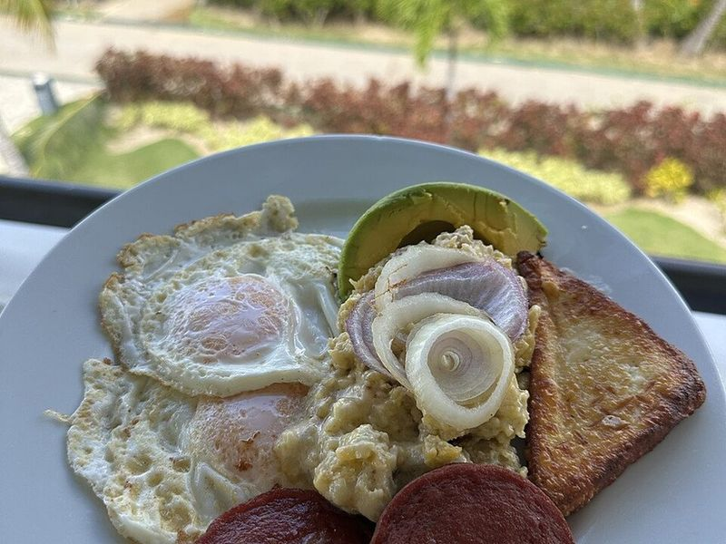

# Dominican Mangú con los Tres Golpes

Photo: Danimsosa · CC BY-SA 4.0 · [source](https://commons.wikimedia.org/wiki/File:Mangu.jpg)

**Breakfast** · Puerto Rican & Dominican · 40 min · serves 4 · skill 2/3

> Silky mashed green plantains under tangy vinegar onions, served with the 'three hits': fried salami, crisp golden frying cheese and fried eggs. It's the classic Dominican breakfast.

| Per serving | kcal | Protein | Carbs | Fat | Fiber | Sodium | Cost |
| --- | --- | --- | --- | --- | --- | --- | --- |
| | 650 | 25 g | 50 g | 42 g | 4 g | 1350 mg | $1.82 |

Contains: pork, egg, dairy

## Ingredients

- 3 green plantains
- 2 medium red onions, thinly sliced
- 4 oz salami, sliced ¼ inch thick
- 6 oz frying cheese, in ½-inch slices
- 4 large eggs

From the pantry: 2 tbsp butter, 1 tbsp olive oil, 2 tbsp oil for frying, 2 tbsp apple cider vinegar, salt, pepper

## Steps

1. Peel the plantains, cut each into 4 pieces and boil in well-salted water until very tender when pierced, 20 to 25 minutes. Save 1 cup of the cooking water before draining.
2. Meanwhile, cook the onions in the olive oil over low heat until soft and pink, about 8 minutes. Add the vinegar and a pinch of salt and pepper, and cook 1 minute more.
3. Mash the hot plantains with the butter, adding the cooking water a splash at a time, until smooth and creamy. Keep it a little looser than you want, since it firms up as it sits.
4. Heat the frying oil in a nonstick skillet over medium-high. Fry the salami until browned at the edges, 1 to 2 minutes per side, then fry the cheese until crusty and golden, about 1 minute per side.
5. Lower the heat to medium and fry the eggs in the same pan until the whites are set and the edges are lacy. Serve the mangú topped with onions, with the salami, cheese and eggs alongside.

**Tip:** Look for Dominican salami (Induveca or Campesino) and queso de freír in Latin markets; Genoa salami and halloumi are good stand-ins.

Adapted from [Dominican Cooking](https://www.dominicancooking.com/45141/tres-golpes-breakfast).

## Storing

Fridge 2 days · freezer not recommended. Refrigerate the mangú separately. Reheat it with a splash of water in the microwave, mashing again, and fry the toppings fresh.

