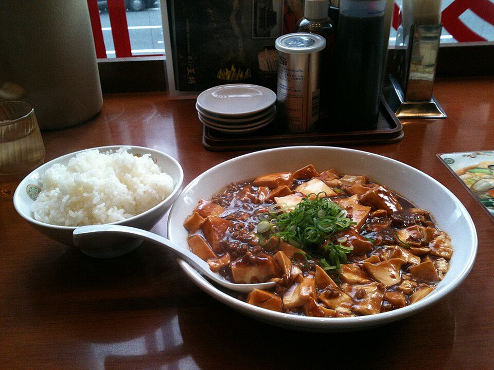

# Mapo Tofu

Photo: Laitr Keiows · CC BY-SA 3.0 · [source](https://commons.wikimedia.org/wiki/File:Mabodoufu_with_rice.jpg)

**Dinner** · Sichuan & Hunan · 25 min · serves 4 · skill 2/3

> Silky tofu in a fiery, savory Sichuan-style sauce with a little ground pork, ginger and garlic, spooned over rice.

| Per serving | kcal | Protein | Carbs | Fat | Fiber | Sodium | Cost |
| --- | --- | --- | --- | --- | --- | --- | --- |
| | 655 | 36 g | 58 g | 31 g | 3 g | 780 mg | $1.99 |

Contains: pork, gluten, spicy

## Ingredients

- 28 oz soft or medium tofu, in ¾-inch cubes
- 8 oz ground pork
- 3 tbsp chili crisp (or chili bean paste)
- 2 tbsp soy sauce
- 4 garlic cloves
- 1-inch ginger
- 1 cup broth
- green onions
- 1½ cups rice

From the pantry: 1 tbsp oil, 1 tbsp cornstarch, 1 tsp sugar, 1 tsp Sichuan peppercorns, ground (optional)

## Steps

1. Start the rice. Slide the tofu into gently simmering salted water for 2 minutes to firm it up. Drain.
2. Brown the pork in the oil over medium-high until crisp, 4 minutes. Add the garlic, ginger and chili crisp for 1 minute.
3. Add the broth, soy and sugar and bring to a simmer.
4. Slide in the tofu and simmer 3 minutes without stirring hard. Push the tofu gently with the back of a spoon so it doesn't break.
5. Thicken with the cornstarch mixed with 2 tbsp water. Finish with Sichuan pepper and green onions. Serve over rice.

**Tip:** Swap the pork for chopped mushrooms to make it vegetarian.

## Storing

Fridge 3 days · freezer not recommended. Reheat gently in a covered pan or the microwave, stirring carefully.

## Other ways to make it

- Chicken
- Steak
- Shrimp
- Pork
