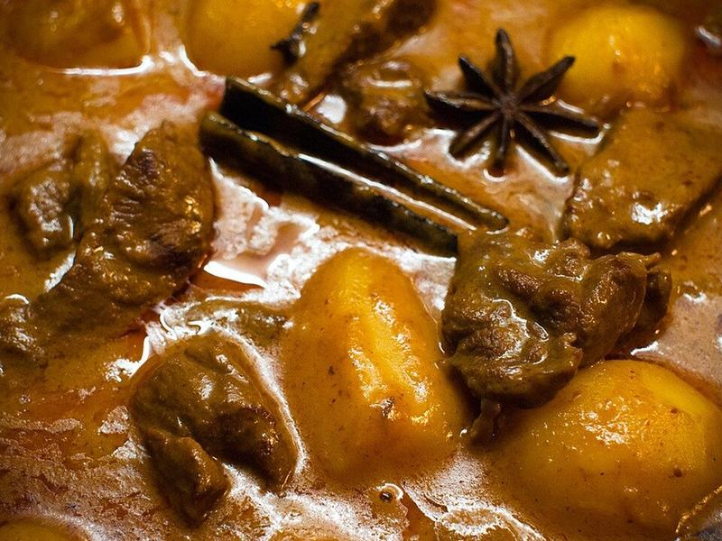

# Massaman Beef & Potato Curry

Photo: Takeaway · CC BY-SA 4.0 · [source](https://commons.wikimedia.org/wiki/File:Matsaman_nuea.jpg)

**Dinner** · Thai · 150 min · serves 6 · skill 2/3

> Chunks of beef braised until spoon-tender in a mellow, warmly spiced coconut curry with potatoes and roasted peanuts. It's Thailand's coziest curry and gentle on heat.

| Per serving | kcal | Protein | Carbs | Fat | Fiber | Sodium | Cost |
| --- | --- | --- | --- | --- | --- | --- | --- |
| | 900 | 39 g | 71 g | 52 g | 5 g | 1350 mg | $3.40 |

Contains: beef, nuts, fish

## Ingredients

- 2 lb beef chuck, in 1½-inch cubes
- 1½ cans (13.5 oz each) coconut milk
- 3 oz (about ⅓ cup) red curry paste
- 1½ lb baby gold potatoes, halved
- 1 onion, in thick wedges
- ⅓ cup roasted peanuts
- 2 tbsp fish sauce
- 1 lime, juiced
- a handful of cilantro
- 1½ cups jasmine rice

From the pantry: 1 tbsp oil, 2 tbsp brown sugar, 1 tsp ground cinnamon, ½ tsp ground cardamom, 1 tsp ground cumin, 2 bay leaves, salt

## Steps

1. Pat the beef dry and season with salt. Brown it in the oil in a Dutch oven over medium-high heat, in batches, 3 to 4 minutes per side. Move to a plate.
2. Lower the heat to medium. Spoon the thick cream from the top of one can of coconut milk into the pot and fry the curry paste, cinnamon, cardamom and cumin in it, stirring, until fragrant and the oil separates, 2 to 3 minutes.
3. Return the beef. Add the rest of the coconut milk, 1½ cups water, the brown sugar, fish sauce and bay leaves. Bring to a simmer, cover and cook on low for 1½ hours, stirring now and then.
4. Add the potatoes, onion and peanuts and simmer, partly covered, until the beef is fork-tender and the potatoes are soft, 25 to 30 minutes. Start the rice meanwhile.
5. Stir in the lime juice and taste. It should be salty, sweet and a little tangy, so adjust with fish sauce, sugar or lime. Serve over rice with cilantro.

**Tip:** Many brands don't sell massaman paste, so red curry paste plus cinnamon, cardamom and cumin gets you close. If you find Maesri or Mae Ploy massaman paste, use it instead and skip the dried spices.

## Storing

Fridge 5 days · freezer up to 3 months. Reheat gently on the stove with a splash of water until bubbling. The flavor deepens overnight.

