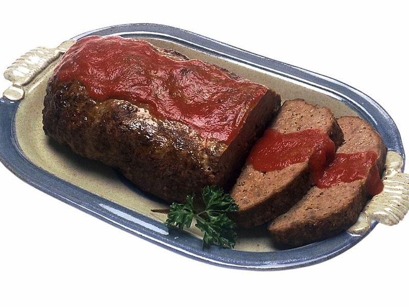

# Glazed Meatloaf with Mashed Potatoes

Photo: Renee Comet (photographer) · Public domain · [source](https://commons.wikimedia.org/wiki/File:MeatloafWithSauce.jpg)

**Dinner** · American comfort · 75 min · serves 6 · skill 1/3

> Tender, juicy meatloaf with a sticky brown-sugar ketchup glaze, buttery mashed potatoes and garlicky green beans. Diner comfort at home.

| Per serving | kcal | Protein | Carbs | Fat | Fiber | Sodium | Cost |
| --- | --- | --- | --- | --- | --- | --- | --- |
| | 765 | 36 g | 61 g | 42 g | 7 g | 650 mg | $2.65 |

Contains: beef, dairy, gluten, egg

## Ingredients

- 2 lb ground beef
- ¾ cup panko
- ½ cup milk
- 2 eggs
- 1 onion, grated
- 2½ lb russet potatoes
- 5 tbsp butter
- 12 oz green beans
- garlic

From the pantry: Glaze: ½ cup ketchup, 2 tbsp brown sugar, 1 tbsp vinegar. Plus 1 tbsp Worcestershire, salt, pepper

## Steps

1. Heat the oven to 375°F. Soak the panko in the milk 5 minutes, then gently mix with the beef, eggs, onion, Worcestershire, 2 tsp salt and pepper. Don't overmix.
2. Shape into a loaf on a lined sheet pan. Brush with half the glaze and bake 45 minutes. Brush with the rest and bake 10 to 15 minutes more, to 160°F inside.
3. Boil the peeled, chunked potatoes until tender. Mash with 4 tbsp butter, warm milk and salt.
4. Sauté the green beans in the remaining butter with garlic until blistered.
5. Rest the meatloaf 10 minutes, then slice thick and serve with the potatoes and beans.

**Tip:** Baking it free-form on a sheet pan instead of in a loaf tin gives more glazed, caramelized crust.

## Storing

Fridge 4 days · freezer up to 3 months. Reheat slices in a skillet or microwave. Leftovers make great sandwiches.

## Other ways to make it

- Ground turkey
- Ground pork
- Italian sausage
- Lentils (veg)
