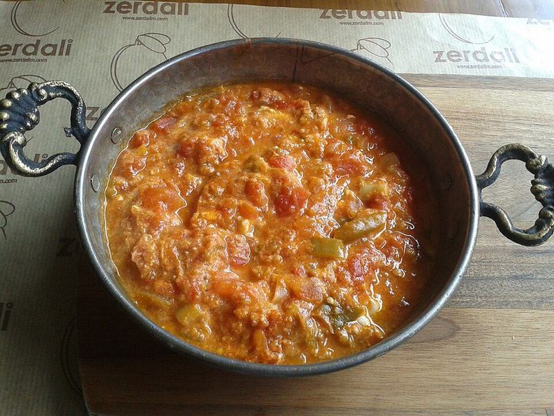

# Menemen (Turkish Scrambled Eggs with Tomatoes & Peppers)

Photo: E4024 · CC BY-SA 4.0 · [source](https://commons.wikimedia.org/wiki/File:Menemen_in_a_sahan.jpg)

**Breakfast** · Turkish · 25 min · serves 4 · skill 1/3

> Soft, saucy eggs scrambled into sweet stewed peppers and fresh tomatoes with a little feta and chile, meant for scooping up with crusty bread.

| Per serving | kcal | Protein | Carbs | Fat | Fiber | Sodium | Cost |
| --- | --- | --- | --- | --- | --- | --- | --- |
| | 610 | 27 g | 61 g | 30 g | 6 g | 1200 mg | $2.19 |

Contains: egg, dairy, gluten

## Ingredients

- 8 eggs
- 1 lb Roma tomatoes, grated or finely chopped
- 2 bell peppers (green or a mix), thinly sliced
- 1 small onion, diced
- 3 oz crumbled feta
- a small handful parsley, chopped
- 8 oz crusty sourdough, sliced and toasted

From the pantry: 3 tbsp olive oil, 1 tbsp butter, 1 tsp Aleppo pepper or ½ tsp red pepper flakes, salt, pepper

## Steps

1. Warm the olive oil and butter in a large skillet over medium. Add the onion and peppers with a pinch of salt and cook, stirring, until soft and sweet, 8 to 10 minutes.
2. Add the tomatoes and Aleppo pepper and simmer until most of the liquid has cooked off and it looks like a chunky sauce, 6 to 8 minutes.
3. Beat the eggs with a pinch of salt and pepper. Lower the heat to medium-low and pour them in.
4. Stir slowly with a spatula, pulling the eggs through the sauce, until they are just set into soft, creamy curds, 2 to 3 minutes. Take the pan off the heat while they still look slightly wet.
5. Scatter the feta and parsley over and serve right from the pan with the toasted bread.

**Tip:** Grating the tomatoes on a box grater (skin side out) gives a smooth sauce and leaves the tough skins behind in your hand.

## Storing

Fridge 1 days · freezer not recommended. Best eaten right away. The pepper and tomato base keeps 3 days; reheat it and add fresh eggs.

