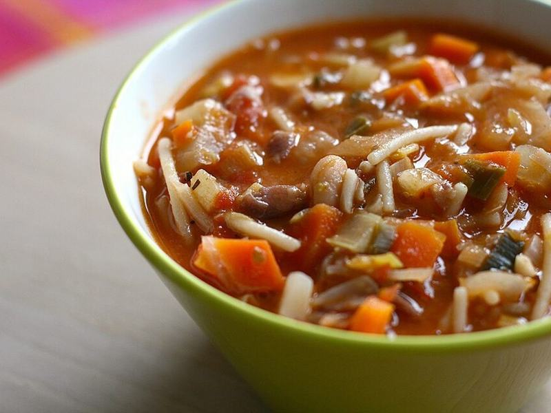

# Hearty Minestrone with White Beans & Pasta

Photo: Katrin Morenz from Aachen, Deutschland · CC BY-SA 2.0 · [source](https://commons.wikimedia.org/wiki/File:Minestrone_soup.jpg)

**Lunch** · Italian · 50 min · serves 6 · skill 1/3

> A thick, tomatoey vegetable soup loaded with two kinds of beans, green beans, spinach and little elbows, finished with plenty of Parmesan and crusty bread.

| Per serving | kcal | Protein | Carbs | Fat | Fiber | Sodium | Cost |
| --- | --- | --- | --- | --- | --- | --- | --- |
| | 515 | 22 g | 83 g | 11 g | 11 g | 2190 mg | $2.25 |

Contains: gluten, dairy

## Ingredients

- 8 cups (2 cartons) vegetable broth
- 1 can diced tomatoes
- 1 can cannellini beans, drained
- 1 can kidney beans, drained
- 1½ cups elbow macaroni or ditalini
- 2 carrots, diced
- 2 celery stalks, diced
- 1 onion, diced
- 4 garlic cloves, minced
- 8 oz green beans, in 1-inch pieces
- 5 oz baby spinach
- ⅔ cup grated Parmesan, plus a rind if you have one
- 1 baguette, for serving

From the pantry: 3 tbsp olive oil, 2 tbsp tomato paste, 1 tsp dried oregano, 1 tsp dried basil, ¼ tsp chili flakes, 1 bay leaf, salt, pepper

## Steps

1. Warm the olive oil in a large pot over medium heat. Add the onion, carrots and celery with a pinch of salt and cook until softened, 8 to 10 minutes.
2. Stir in the garlic, tomato paste, oregano, basil and chili flakes and cook until the paste darkens, about 2 minutes.
3. Add the broth, diced tomatoes, both beans, the bay leaf and the Parmesan rind if using. Bring to a boil, then simmer 15 minutes.
4. Add the green beans and pasta and simmer, stirring now and then, until the pasta is tender, 9 to 10 minutes.
5. Stir in the spinach until wilted, remove the bay leaf and rind, and season with salt and pepper. Serve topped with Parmesan and a drizzle of olive oil, with sliced baguette.

**Tip:** The soup thickens a lot as it sits; thin leftovers with a cup of water or broth when you reheat.

## Storing

Fridge 5 days · freezer up to 3 months. Reheat on the stove with a splash of water. Pasta softens after freezing, so you can freeze the soup before adding it.

