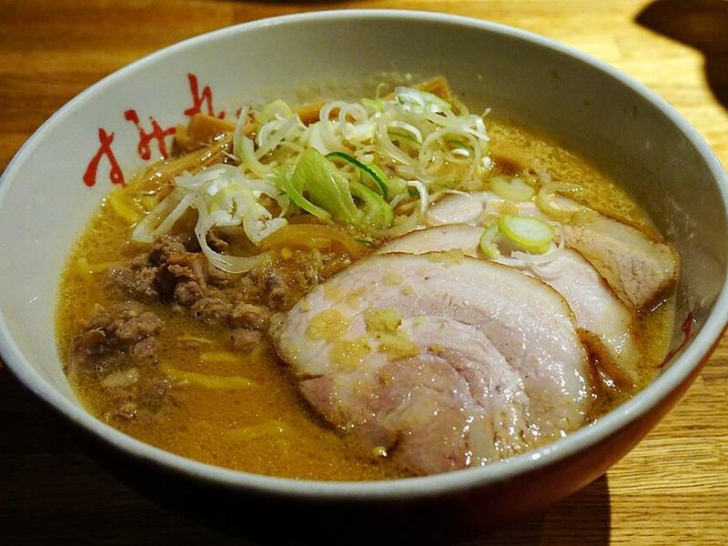

# Spicy Miso Ramen with Jammy Eggs

Photo: 663highland · CC BY 2.5 · [source](https://commons.wikimedia.org/wiki/File:151010_Sapporo_ramen_at_Susukino_Sapporo_Hokkaido_Japan01s.jpg)

**Dinner** · Japanese · 30 min · serves 4 · skill 2/3

> A rich, savory miso-and-sesame broth with spicy ground pork, springy noodles, sweet corn, spinach and 6½-minute jammy eggs.

| Per serving | kcal | Protein | Carbs | Fat | Fiber | Sodium | Cost |
| --- | --- | --- | --- | --- | --- | --- | --- |
| | 730 | 35 g | 77 g | 32 g | 6 g | 3170 mg | $3.14 |

Contains: pork, gluten, egg, sesame, spicy

## Ingredients

- 10 oz ramen noodles
- 8 oz ground pork
- 8 cups chicken broth
- ⅓ cup white miso
- 4 garlic cloves, grated
- 1-inch ginger, grated
- 4 eggs
- 1 cup corn
- 3 handfuls spinach
- green onions
- chili crisp
- sesame seeds

From the pantry: 1 tbsp sesame oil, 2 tbsp soy sauce, 1 tbsp tahini or peanut butter (optional)

## Steps

1. Boil the eggs for 6½ minutes, then ice them. Peel and marinate in a splash of soy sauce while you cook.
2. Brown the pork in the sesame oil until crisp. Add the garlic, ginger and 1 tbsp chili crisp for 1 minute.
3. Add the broth and bring to a simmer. Whisk the miso (and tahini) with a ladle of broth until smooth and stir it back in. Don't boil it after adding the miso.
4. Cook the noodles separately and divide among bowls. Add the spinach and corn to the hot broth for 1 minute.
5. Ladle the broth over the noodles. Top with halved eggs, green onions, sesame and more chili crisp.

**Tip:** Cook the noodles in a separate pot so their starch doesn't cloud the broth.

## Storing

Fridge 3 days · freezer up to 3 months. Store broth, noodles and toppings separately. Freeze only the broth. Reheat the broth to a simmer and pour over the noodles.

## Other ways to make it

- Ground beef
- Ground turkey
- Italian sausage
- Lentils (veg)
