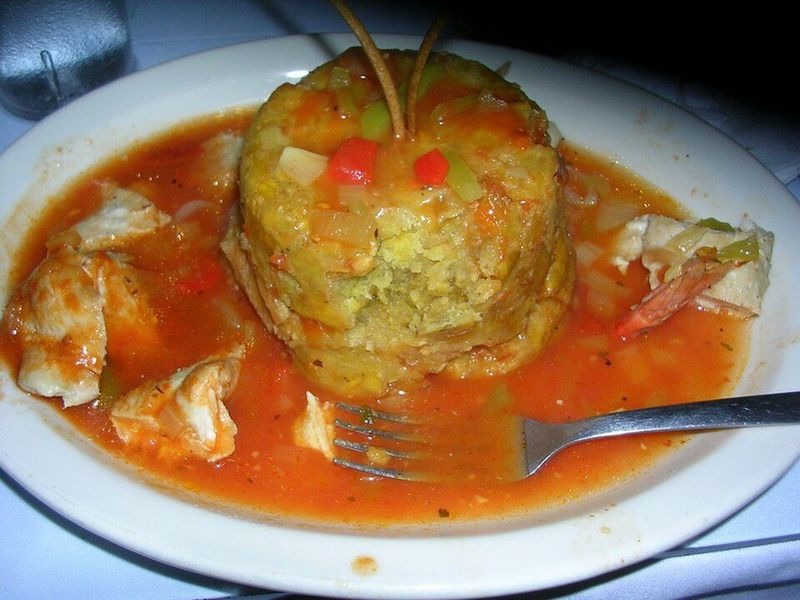

# Garlic Mofongo with Shrimp in Criollo Sauce

Photo: Diane · CC BY 2.0 · [source](https://commons.wikimedia.org/wiki/File:Mofongo.jpg)

**Dinner** · Puerto Rican & Dominican · 50 min · serves 4 · skill 2/3

> Fried green plantains mashed with lots of garlic, butter and crisp pork, packed into domes and smothered in garlicky shrimp with tomato and cilantro. It's Puerto Rico's most famous plate.

| Per serving | kcal | Protein | Carbs | Fat | Fiber | Sodium | Cost |
| --- | --- | --- | --- | --- | --- | --- | --- |
| | 780 | 42 g | 80 g | 38 g | 7 g | 1210 mg | $4.52 |

Contains: shellfish, pork, dairy

## Ingredients

- 5 green plantains
- 1½ lb large raw shrimp, peeled and deveined
- 10 garlic cloves
- 3 tbsp butter
- 3 oz thick-cut bacon (in place of chicharrón)
- ½ onion, finely chopped
- 2 plum tomatoes, chopped
- ½ bunch cilantro, chopped
- 1½ cups chicken broth
- 1 lime, juiced

From the pantry: 3 tbsp olive oil, oil for frying, ½ tsp ground cumin, ½ tsp smoked paprika, salt, pepper

## Steps

1. Cook the bacon in a skillet over medium heat until very crisp, then crumble it. Mash 8 garlic cloves with ½ tsp salt and 2 tbsp olive oil into a paste (a mortar or the side of a knife works). Mince the other 2 cloves.
2. Peel the plantains and cut into 1-inch slices. Heat 1 inch of oil in a heavy pot to 350°F and fry the slices in batches until golden and cooked through but not hard, 3 to 4 minutes per side. Drain.
3. For the shrimp, melt the butter with the remaining olive oil in a large skillet over medium heat. Soften the onion for 3 minutes, add the minced garlic, tomatoes, cumin and paprika and cook 2 minutes, then add the broth and simmer 5 minutes.
4. Add the seasoned shrimp and simmer until just pink, 3 to 4 minutes. Stir in the lime juice and most of the cilantro, then season with salt and pepper.
5. While the plantains are hot, mash them in batches with the garlic paste, the bacon and a few spoonfuls of the shrimp sauce until they hold together but stay a little chunky.
6. Press each portion into a small bowl, turn it out onto a plate, make a well in the top and spoon the shrimp and plenty of sauce over and around it. Finish with cilantro.

**Tip:** Mash the plantains while they're hot, since they stiffen as they cool. A pilón (wooden mortar) is traditional, but a potato masher in a sturdy bowl works.

Adapted from [Irma Cádiz, CT Public](https://content.ctpublic.org/?p=59837).

## Storing

Fridge 2 days · freezer not recommended. Mofongo is best fresh. Refrigerate the shrimp sauce separately and reheat gently; reheat mofongo covered in the microwave with a splash of broth.

